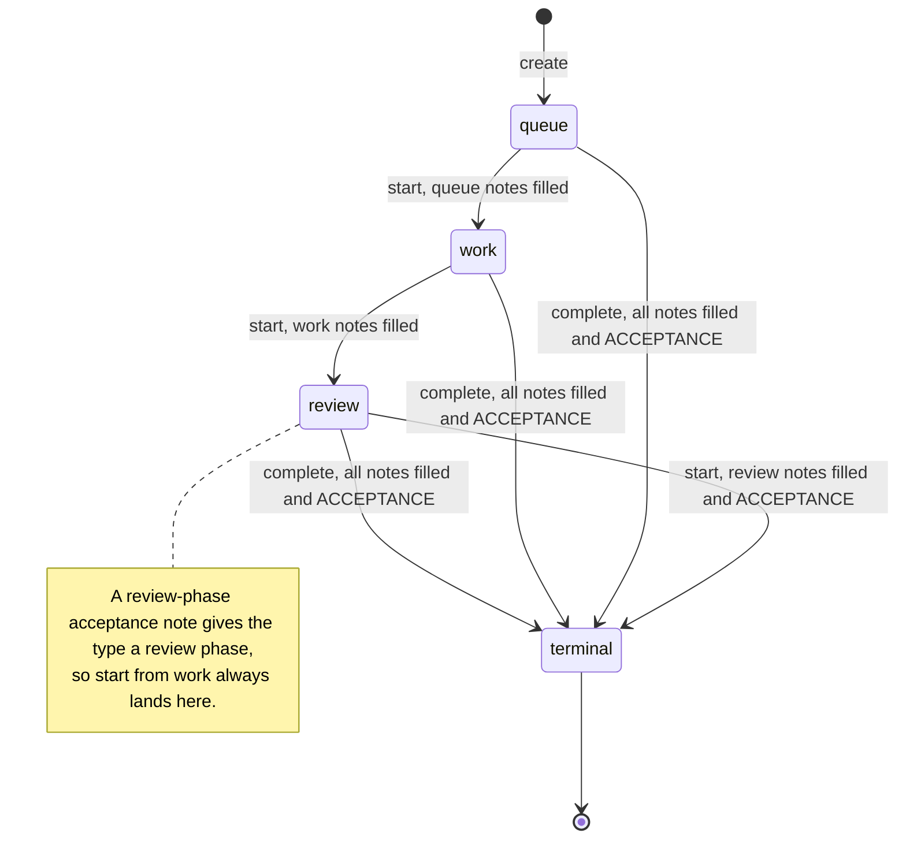
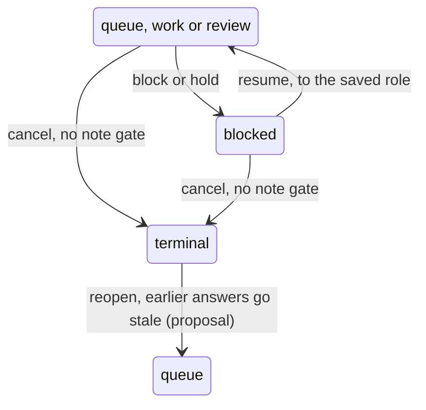
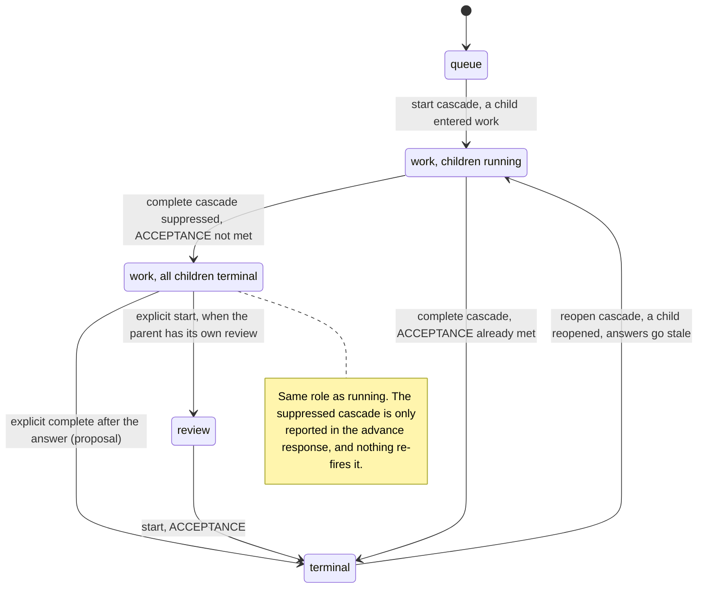
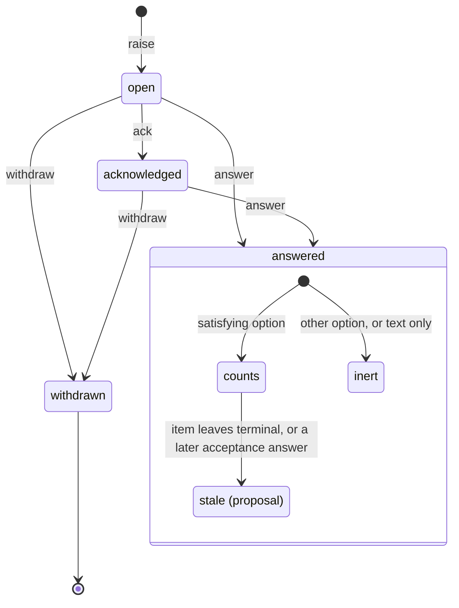
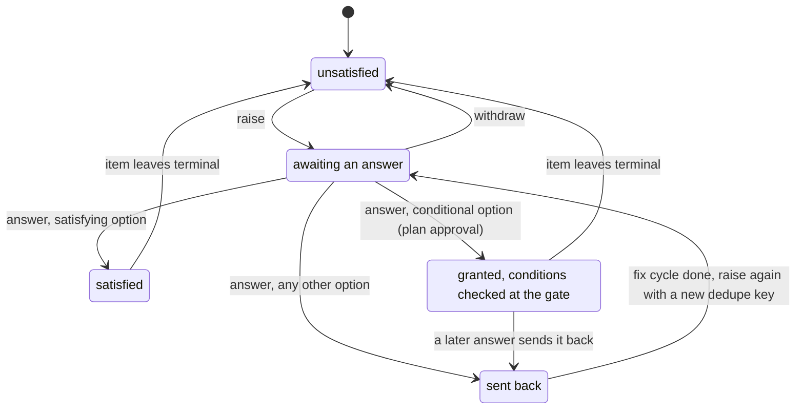

# Acceptance gate states

**Status:** Proposal for the owner to decide. Nothing here is settled. | **Date:** 2026-11-24 | **Base:** main at `256b2bd34`

## Purpose

[0008](decisions/0008-acceptance-is-a-server-gate.md) makes acceptance a server gate, and [0012](decisions/0012-acceptance-gate-note-form.md) gives it the note form: a required acceptance note that counts as filled only when an answered decision of a named decision class, with a named option, exists for the item. This document draws that gate as state machines: the item's phases, the decision's own states, and how events on one move the other. It then uses the diagrams to propose answers to the six questions 0012 leaves for P4's design (see [architecture-breakdown.md](architecture-breakdown.md), "Gate form"), and lists the new questions the diagrams exposed. Every answer below is a proposal.

Terms follow [GLOSSARY.md](../GLOSSARY.md). Two words used here are proposals, not glossary terms: a **stale answer** (an answer that no longer satisfies the gate) and a **satisfying option** (an option key the acceptance note entry names, as 0012 uses the phrase).

## Today

Paths are relative to `current/src/main/kotlin/io/github/jpicklyk/mcptask/current/`. Line numbers are as of `256b2bd34` and go stale as the code moves.

**Item phases.**

- Five roles: queue, work, review, blocked, terminal (`model/item/Role.kt:8-14`). Seven user triggers: start, complete, block, hold, resume, cancel, reopen (`domain/lifecycle/Trigger.kt:14-20`).
- The transition table is data (`domain/lifecycle/TransitionTable.kt:78-114`). `start` from work goes to review when the schema has a review phase, else to terminal (`TransitionTable.kt:90`, `:157`). `start` from review goes to terminal (`:98`). `complete` goes to terminal from queue, work or review. `cancel` goes to terminal from every non-terminal role. `reopen` goes from terminal to queue (`:109-112`).
- A type has a review phase when any of its notes has role review (`model/schema/WorkItemSchema.kt:40`).
- Gates run in a fixed order, first failure wins: ownership, seat, table, warrant, hold, review-pending, dependency, note, lease (`domain/lifecycle/TransitionPolicy.kt:503-514`).
- The note gate's scope (`TransitionPolicy.kt:61-68`): `start` and the start cascade check the current phase's required notes; `complete` and a complete cascade check every phase; a complete cascade whose chain began with `cancel` skips the note gate; every other trigger, `cancel` included, skips it.
- "Filled" means a non-blank body (`application/service/GatePredicate.kt:45`). The snapshot loader computes the filled keys only for triggers the note gate covers (`application/service/TransitionSnapshotLoader.kt:146-155`, `:283-288`). The same unit can already read the item's decisions (`application/port/LifecycleStoreProvider.kt:22`, `:37-42`).
- Every applied transition sets `roleChangedAt` and records an `item.transitioned` event with its from and to roles (`application/service/AdvanceService.kt:1076`, `:1119-1136`). Leaving terminal re-pins the item to the config heads (`AdvanceService.kt:1087-1095`). The event store can read an item's events by type, newest first (`platform/port/EventStore.kt:84-90`).

**Lifecycle modes and the cascade.**

- Four modes: auto, manual, permanent, none (`model/item/LifecycleMode.kt:15-18`). Cascades apply only under auto (`TransitionTable.kt:161`); manual and permanent parents move only by explicit triggers; a lifecycle-free item has no role at all.
- A child's transition queues a follow-up on its parent: a complete cascade when the child reaches terminal, a reopen cascade on `reopen`, a start cascade when a child enters work (`TransitionPolicy.kt:456-471`). The cancel origin is set by the trigger of the child that ended the chain (`TransitionPolicy.kt:464`).
- A complete cascade needs every child terminal (`TransitionPolicy.kt:167-176`) and never moves a parent out of review (`TransitionPolicy.kt:195-217`).
- A cascade the note gate refuses is reported as a suppressed event naming the missing notes (`AdvanceService.kt:1356-1363`). Nothing re-evaluates it later: follow-ups come only from a child's own transition.

**Decisions.**

- Four statuses: open, acknowledged, answered, withdrawn (`model/run/DecisionRequest.kt:7-13`). Answered and withdrawn are final; acknowledging, answering or withdrawing a final decision is `decision_closed` (`application/decision/DecisionService.kt:38-41`).
- Options belong to each decision, not to its class (`DecisionRequest.kt:110`). A freeform class may be answered with text and no option (`DecisionService.kt:199-203`). The answer records the option, rationale, who answered, through which profile, and `answeredAt` (`DecisionRequest.kt:74-88`, `DecisionService.kt:219-236`).
- Raise returns the existing request when one with the same root, scope key and dedupe key is not withdrawn, answered ones included (`DecisionService.kt:110-114`).
- Withdraw needs the raiser or the run's token (`DecisionService.kt:45-47`). Nothing withdraws a decision when its item is cancelled or reopened.
- Who may answer: `human-only` admits a human credential with a real proof and no seat token; `director-or-human` also admits a call on the director profile with no seat token; `any-actor` admits anyone (`application/decision/DecisionCommands.kt:46-61`, `interfaces/shared/tools/runs/RunPermissions.kt:42`). The `answer` op is served on the director profile only (`interfaces/shared/tools/runs/RunsAnswerOp.kt:25`).
- Over stdio every call runs as the local principal: kind agent, proof none (`platform/call/LocalPrincipal.kt:16-23`, `bootstrap/CurrentMcpServer.kt:323`), so it is never a human. A stdio process serves one profile, chosen by `MCP_TOOL_PROFILE` (`CurrentMcpServer.kt:181-190`).
- An answer never moves the item. In Claude Code the `decision-guard` hook also denies a subagent's `answer` (`claude-plugins/task-orchestrator/hooks/decision-guard.mjs:3-15`); other harnesses have no such hook.

## Diagrams

In every diagram ACCEPTANCE marks where the proposed gate is checked. The acceptance note is shown as a review-phase note; why is new question 1.

### 1. Item phases: the progression and the gate

### 2. Item phases: side exits that skip or reset the gate

### 3. An auto parent: the cascade and the gate

### 4. The decision's own states

Today's four statuses, with the proposed split of answered into the answers that count and those that do not. Stale is derived at gate time, never stored: answered stays final.

### 5. How the two interact: the gate as the item sees it

The gate's state is not stored. The server derives it from the item's decisions of the acceptance class each time a gated transition is evaluated (proposal).

Which events move which machine:

| Event | Item phase | Decision | Gate, as the item sees it |
|---|---|---|---|
| `raise` (acceptance class) | none | none to open | unsatisfied to awaiting |
| `answer`, satisfying option | none: an answer never moves the item | open or acknowledged to answered | to satisfied |
| `answer`, conditional option | none | to answered | to granted |
| `answer`, other option (send-back) | none; the item stays in review for the fix cycle | to answered | to sent back |
| `withdraw` | none | to withdrawn | back to unsatisfied |
| `start` from review, `complete`, complete cascade | to terminal only if the gate passes | none | read, never changed |
| `cancel` | to terminal, gate skipped | none; an open one stays open | not read |
| `reopen`, reopen cascade | terminal to queue, or to work | none | every earlier answer goes stale |

## Proposed answers to the open questions

| # | Question | Proposed answer | Alternatives and why not | Code cost | Record |
|---|---|---|---|---|---|
| 1 | Option pinning | Only a named option satisfies. The note entry names the class and the satisfying option keys, as 0012 says. Add: of the item's answered decisions of that class, only the latest answer counts, so a send-back after a grant voids the grant. A text-only freeform answer never satisfies. | Any answer of the class: a send-back would satisfy the gate. Options declared on the class: options are per decision today (`DecisionRequest.kt:110`), so this is a wider change. The recommended option: it is the raiser's choice, not the answer. | The note entry field, parser, validator (keys match the option-key pattern) and JSON schema; one predicate in `GatePredicate`; the loader reads the item's decisions. Inside form N's 8 to 10 files. | "Latest answer counts" refines 0012: a new record. |
| 2 | Stale answers after reopen | An answer counts only if `answeredAt` is later than the item's last exit from terminal, by `reopen` or by a reopen cascade. Read it from the newest `item.transitioned` event with from-role terminal (`EventStore.kt:84-90`). Stale is derived, not a status. A grant given before a reopen must be given again. | A new `reopened_at` column: a migration, against form N's costing. Withdraw answers on reopen: answered is final (`DecisionService.kt:38-41`). Compare with `roleChangedAt`: it changes on every transition (`AdvanceService.kt:1076`), so it would void a plan-time grant at the first phase change. | The loader gains an event read; it is a new constructor parameter, so it must be wired by hand at `AdvanceServiceFactory.forItem()` (CLAUDE.md, single construction sites). The accept skill raises with a dedupe key unique to each pass. | None for the rule, which 0012 states. A column instead of events reverses 0012's no-migration costing and needs a record. |
| 3 | Does cancel skip the gate? | Yes for the item's own `cancel`, as for every note gate today. No for a cancel-origin complete cascade: it still checks the acceptance note, because the origin is set by whichever child ended last (`TransitionPolicy.kt:464`), so a parent whose other children delivered would skip acceptance. A parent whose children were all cancelled is cancelled explicitly. Ship and merge key on the answer, never on terminal. | Skip on every cancel origin, as 0012 leans: lets delivered work pass unaccepted. Track per child whether it was cancelled: more reads for no gain over an explicit cancel. | `noteScopeOf` and the loader's `noteGateApplies` gain a case: a cancel-origin cascade checks the acceptance keys only (`TransitionPolicy.kt:61-68`, `TransitionSnapshotLoader.kt:283-288`). One test per case. | Amends 0012's "cancel still skips the note gate": a new record. |
| 4 | The conditional grant | It is an answered decision whose option is on a second list in the note entry: options that satisfy only under conditions (field name to be chosen). It fires only when someone sends a transition into terminal; it never moves the item. At that moment the server checks what it holds: the class and option, an answer after the last exit from terminal, the latest answer (question 1), no other open or acknowledged decision on the item, and the review notes filled, which the note gate already checks. The rest are client claims, checked by the accept card before the orchestrator sends the advance and recorded in the advance summary: the verdict is Pass, every finding is disposed, the build is green at HEAD. | The server parses the verdict from the review note body: the gate reads no bodies (`GatePredicate.kt:45`). The server holds build state: no link to outside tools ([0011](decisions/0011-no-sync-with-outside-tools.md)). The grant moves the item when the conditions hold: an answer never moves an item. | The second option list in the entry; one more predicate; a pending-decision read in the loader (`LifecycleStoreProvider.kt:37-42`). Plugin: the accept card's checks and the post-plan grant. | The split between server checks and client claims refines 0008: a new record. |
| 5 | stdio and `director-or-human` | Today only a director-profile stdio process can answer, and it answers as the local principal. Proposal: until P2, setup registers a second stdio entry with `MCP_TOOL_PROFILE=director`, and the user's session relays the user's yes there with the user's words as the rationale. After P2, `answer` is served on every profile that needs it, and `director-or-human` admits any call without a seat token whose credential carries `decide`. The seat-token refusal is the server's rule on every harness. The Claude Code subagent hook is an extra guard on that harness only. The record is provenance, not proof (0008). | `any-actor` for acceptance: a seat could accept its own work. `human-only`: never answerable over stdio. A harness-specific check for a human: breaks 0008's "every surface the same way". | Until P2: setup and init only. After P2: covered by P2's role-neutral surface. Plus the validator warning 0012 names. | None: 0003, 0008 and 0012 cover it. |
| 6 | Auto parents | Yes, the gate stops the cascade. The note gate refuses the complete cascade, and the parent waits in work with every child terminal. Nothing re-fires a suppressed cascade, so after the answer the accept skill sends an explicit `complete`, as 0012 leans. If the acceptance was already satisfied (a grant whose conditions hold), the cascade completes the parent with no extra step. The suppressed event already names the missing acceptance key, so the orchestrator knows when to raise. | The answer re-fires the cascade: an answer would move an item, and the decision service would call the advance service. Skip acceptance in cascades: the gate would mean nothing on a parent. Force gated parents to `manual`: two settings for one intent. | Plugin only: the accept skill's explicit advance and reading the suppressed event. No server change beyond questions 1 to 4. | None: 0012 states it. |

## Acceptance at any depth

The gate is per type and does not look at depth. Each depth reaches it differently.

- **Leaf, a building item.** It moves queue, work, review. The acceptance decision is raised in review after the reviewer's verdict, or the grant was given at plan approval. `start` from review reaches terminal only through the gate. A send-back keeps the item in review for the fix cycle, then a new decision is raised.
- **Story-level parent, auto lifecycle.** Its children are accepted under their own types first, since a child must be terminal before the parent's cascade runs. The parent's complete cascade is suppressed until its own acceptance counts (diagram 3). The verdict is judged on the parent's own notes and the rulings on it, not on its children's acceptances.
- **Epic-level parent.** It behaves like a story-level parent, but with more waiting. Every story under it must be terminal, each accepted or cancelled. The open question is whether "no decision open" means the epic alone or its whole subtree (new question 5).
- **Manual or permanent parent.** No cascade runs, so the gate is met at the explicit `complete`, as on a leaf.
- **Lifecycle-free item.** Never gated: it has no role and never transitions.

## New questions the diagrams exposed

1. **Which phase holds the acceptance note?** A review-phase note gives a type a review phase it may not have had (`WorkItemSchema.kt:40`). A work-phase note is checked when the item leaves work, before any review. Proposal: review. But then the reviewer seat sees the note in its phase, so which seat owns it, and must the hooks stop asking any seat to fill it?
2. **Does the acceptance note's body mean anything?** A body never fills it. Is a body refused, ignored, or kept as the accept card's summary?
3. **Raising again after a send-back or a reopen.** Raising with the same dedupe key returns the old answered decision (`DecisionService.kt:110-114`). The accept skill needs a dedupe key unique to each pass. Or should the server let a new raise replace an answered acceptance decision?
4. **Open acceptance decisions on a cancelled or reopened item.** Nothing withdraws them, so they stay in the decision inbox. Should the orchestrator withdraw them, or the server?
5. **What "no decision open" covers on a parent.** The item alone, or its subtree? Today's decision read has no ancestor filter (`LifecycleStoreProvider.kt:37-42`). P2's `decisions_read list` proposes one.
6. **Explicit `complete` on a parent with open children.** No gate refuses it (the warrant gate covers cascades only, `TransitionPolicy.kt:167-176`). So a parent could be accepted before its children finish. Is that allowed?
7. **A grant on an item that is not refined.** Plan approval approves the queue notes. Should the server refuse a conditional grant while the item's required queue notes are unfilled?
8. **On stdio the director and the user's session look the same.** Both run as `local`, so there `director-or-human` means anyone holding the director connection. Is that the accepted limit, or does the accept card have to say so?
