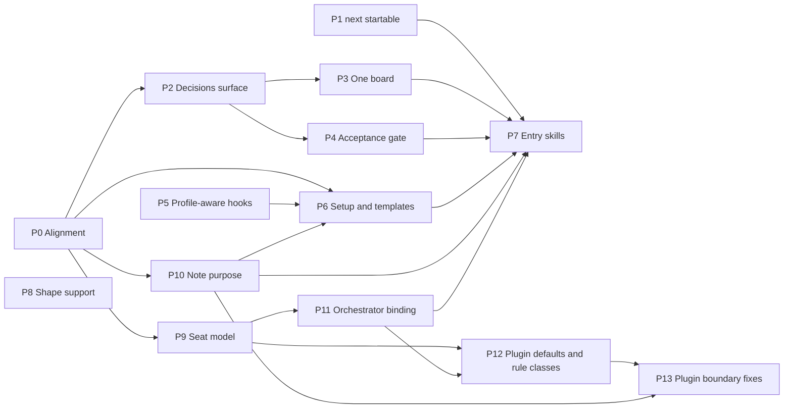

# Architecture breakdown

**Status:** Reviewed; its three decisions are settled (2026-11-24). Each package becomes items only when the owner approves materializing it. | **Date:** 2026-11-24, packages P9-P13 and additions to P2, P4, P6 and P7 on 2026-11-26, and the pass 10 decisions G1-G12 applied the same day

This document turns the settled design into work packages: what each one changes, which layer it lands in, what it depends on and in what order the packages can run. It is the bridge between the design documents in this folder and the work items that will carry the work. It is not an implementation plan: once the owner approves a package, it becomes a parent item, and its planner seat writes the plan.

Inputs: the [decision records](decisions/README.md), the server change table and shared gaps in [entry-skills.html](entry-skills.html), the real gaps and guard rails in [journey-config-fit.html](journey-config-fit.html), and the leaks in [evidence/journey-knowledge-base.md](evidence/journey-knowledge-base.md). Since 2026-11-26 also [target-architecture.md](target-architecture.md), which the packages move the code towards, and [journey-overlay.md](journey-overlay.md), which grades the journeys against it and names, per package, the journey steps it turns into fits.

## Principles every package keeps

- **Interfaces follow domain objects** (work, decision, board), not skills.
- **Authority comes from the decision class and the credential.** A profile only limits how much body text a caller can read ([0003](decisions/0003-role-neutral-decisions-surface.md)).
- **The server computes the states skills keep asking about**: refined, who a decision waits on, accepted.
- **Everything a skill produces links back to its source**: a finding, a node's goal note, a ruling.
- **Method-neutral.** No package adds a method word to the tool ([0006](decisions/0006-method-words-are-schema-vocabulary.md)).
- **4.x stays additive.** Renames keep deprecated aliases until 5.0 ([0005](decisions/0005-renames-with-deprecated-aliases.md)).
- **No enforcement machinery without data.** A package instructs and reports first; it adds a gate only where a decision record says so.
- **The knowledge base keeps working.** Every package respects the 14 guard rails on the [Journey Config Fit](journey-config-fit.html) page ([0010](decisions/0010-two-domains.md)).

## Packages

Sizes are rough: S a day or less, M a few days, L a week or more of agent work.

### P0 Terminology alignment (done)

Completed 2026-11-26 over container `f2b1432b` (15 items): the plugin and docs sweeps, server text, run-token and run-seat renames with aliases, seat-name validation, the steering rename and the knowledge-journey glossary rows. It went first because P2 and P6 edit the same code.

### P1 `next` returns startable work

- **Records:** [0004](decisions/0004-next-means-startable.md).
- **Layer:** server (`NextItemRecommender`, `EligibilityQuery`, the eligibility SQL), then plugin callers.
- **Contents:**
  - Phase 1: leaves only by default (`includeParents` opts out), and a `builds: false` property on a schema or trait, pinned on the item, that keeps questions and containers away from build seats. `claim` by selector shares the eligibility.
  - Phase 2: `refined` computed by the server (every required queue-phase note filled), a `refined` filter on `next` and `list`.
  - Plugin: ralph, the run-wave frontier and post-plan route 3 drop their own filtering.
- **Depends on:** nothing for phase 1. Phase 2 needs the refined storage (a filled flag on notes plus the pinned required keys).
- **Size:** M. **Risk:** low; it is the fix every caller already works around. Traversal across parents stays held; the sibling rank that orders `next` lands in P8 ([0013](decisions/0013-sibling-rank.md)).

### P2 Decisions surface

- **Records:** [0003](decisions/0003-role-neutral-decisions-surface.md), [0005](decisions/0005-renames-with-deprecated-aliases.md).
- **Layer:** server (new tools, one additive migration), hooks.
- **Contents:**
  - `decisions_read list` and `decisions_write raise | ack | delegate | escalate | answer | withdraw`, on every profile that needs them. The `runs_*` decision ops stay as deprecated aliases.
  - `waitingOn: director | user` with `waitingReason`; status unchanged.
  - Authority from the class's `answerers` plus a credential that grants `decide` (the `director-or-human` test changes from "served on the director profile").
  - Per-class `autonomy: answer | ask`, default ask.
  - Answer provenance: `decidedBy`, `basis`, `relayed`, `withinAutonomy`, evidence links.
  - `resume` refused while the item's blocking decision is pending: a decision gate on `resume`, which today checks only the blocked role and a restorable previous role (journey 4 step 22 in [journey-sequences.md](journey-sequences.md)).
  - Profile sets: `decisions_read` and every `report` select served on the orchestration profile too, so an orchestrator reads the decision it acts on and the run rollup; `runs_write open` leaves the director profile ([0002](decisions/0002-director-on-orchestrator-tools.md)). Until this lands, director mode uses two connections, as 0002 records.
  - Hooks: `decision-guard` covers `decisions_write`; `director-watch` follows `decisions_read` and the `decision.raised` event.
- **Depends on:** P0 (server text and the run-token renames).
- **Size:** L. **Risk:** the widest tool-contract change; needs an API-compatibility review.

### P3 One board

- **Records:** the board ruling (glossary "Board"); entry-skills investigation 4.
- **Layer:** server (`report board`, every `report` select on the orchestration and director profiles), plugin (one board skill).
- **Contents:**
  - A board read of ids, counts and a closed list of attention kinds (no score); one rendering shared by orchestration mode and director mode, with a way to hand work to the director.
  - A knowledge root gets its own view, recent and untouched entries, and never shows as empty. The board skill composes it from the knowledge profile's own list reads (`items_read` `list` with `createdAfter`, `modifiedBefore` and `sort`, and `overview`), because the knowledge profile serves no `report` and every `report` select is director-only today (`report/internal/wire/ReportRollupSelect.kt:45`). No orphans while the root-wide orphan read is held (pass 10 decision G8).
- **Depends on:** P2 for the decision inbox.
- **Size:** M-L.

### P4 Acceptance gate

- **Records:** [0008](decisions/0008-acceptance-is-a-server-gate.md).
- **Layer:** server (the gate), plugin (accept card, the grant recorded in the user's words, ship step).
- **Contents:**
  - The gate, opt-in per type, as a required acceptance note satisfied only by an answered decision of a named class and option ([0012](decisions/0012-acceptance-gate-note-form.md)).
  - The conditional grant: on a gated type the plan proposal offers it as one plain choice ("yes" or "yes, and accept on green"), and the orchestrator records the user's own words as the answer with the conditional option. It counts only when those words say so, on every host; no hook reads `permission_mode` for it ([0008](decisions/0008-acceptance-is-a-server-gate.md), [0012](decisions/0012-acceptance-gate-note-form.md), amended by pass 10 decision G1). It satisfies the gate only when review passed, findings were disposed, the build is green at HEAD and no decision is open (the accept card's deterministic checks).
  - The claims as evidence: the accept skill raises the acceptance decision with its claims (commit, verify command and result, count of disposed findings) in `context` and `links`, and the gate counts the note filled only when the answered decision carries them. That records the claims; it does not prove the build ([0012](decisions/0012-acceptance-gate-note-form.md)). No separate claims note.
  - The accept mechanics skill: one card, a verbal yes or a send-back. Send-back reuses the fix cycle. On an item in an open run it acts with the run token from the run files, or hands the step to that run's orchestrator; no server rule changes for it ([0016](decisions/0016-seat-capability-and-orchestrator-notes.md)).
  - The ship seam: a run-profile `postRun` step with `when: accept`, running a project rule. On a gated type merge is armed only on acceptance; on an ungated type the project's own merge step arms merge, as today ([0008](decisions/0008-acceptance-is-a-server-gate.md)).
- **Depends on:** P2, since the gate reads answered decisions.
- **Size:** M-L.

### P5 Profile-aware hooks

- **Records:** [0010](decisions/0010-two-domains.md) guard rails 1-3, 6, 9 and 11; pass 10 decisions G6, G7 and G10.
- **Layer:** plugin hooks, three skills and the knowledge mechanics text.
- **Contents:**
  - Hooks learn which tool profile the session is connected through and name only what it serves, or stay silent: `session-start`, `orchestration-context`, the plan-mode hooks, the dispatch guard.
  - `config-sync` pushes no bundled build rules to a root whose declared types are all `lifecycle: none`, and archives the copies pushed before (done: #780, #790).
  - `create-item`, `work-summary` and `dependency-manager` stop framing a lifecycle-free root as bugs, backlog or blockers.
  - Knowledge mechanics text (the knowledge session guidance and the prune moment): nothing deletes an entry or a page without the user's explicit yes, and pruning prefers the archive tag or another tag (guard rail 11). It is generic to every knowledge base, so it is mechanics, not a binding; a binding for project-specific knowledge conduct stays held ([0017](decisions/0017-orchestrator-binding.md)).
  - A write-up goes through the topic's synthesis note when its schema declares one, so the method that note's `skill:` binds is hinted when the note is written (S03).
  - Retrieval and pruning honour the root's maturity rule when it has one (S69): its hidden tags stay out of retrieval, and its archive tag replaces a delete.
- **Depends on:** nothing.
- **Size:** M. **Risk:** low, and it protects real knowledge-base users today.

### P6 Setup and the template library

- **Records:** [0009](decisions/0009-setup-applies-tested-templates.md), [0010](decisions/0010-two-domains.md).
- **Layer:** plugin (the start skill, the library, CI), with config read by the plugin.
- **Contents:**
  - The start skill: check the connected profile, ask the domain, ask two to four work questions with defaults, apply one template including steering, record the template and version, register only the endpoints the domain needs.
  - The library: pre-built templates validated in CI, starting with a light template, a software template with add-ons (acceptance, review, questions and probes, delegated seats) and a knowledge-base template. Built on the ten manage-schemas profiles.
  - Upgrades: compare the recorded template and version, replace what matches a known old version, leave customised parts and report them (the bundled-rules policy).
  - Approval routing: an `extensions.claude-code` key saying what plan approval sets in motion (materialize only, materialize and build inline, or materialize and dispatch), defaulting to today's behaviour and set by each template. The post-plan skill and hook read it instead of deciding it in their own text.
  - Templates mark their notes with note purposes (P10).
  - Template guidance for the build-to-learn small node's `finding` note: the kept and the thrown commits, by SHA. How thrown code leaves a shared branch is a project rule bound through the orchestrator binding or the writing seat's `rules:`; the plugin ships none, since projects differ (revert, squash, no rebase) (pass 10 decision G4).
  - The knowledge template: the topic type gains an optional synthesis note beside the page, whose guidance is a pointer to the page and what it covers and whose `skill:` the user may set (S03, pass 10 decision G6); and a maturity rule document under the plugin-owned key (S69, pass 10 decision G7).
  - start says that learn needs network access to the repository host, a host permission ([0019](decisions/0019-learn-reads-upstream-sources.md)).
  - `init` and `quick-start` fold into start, or call it.
- **Depends on:** P5 (the knowledge template needs profile-aware hooks), the steering rename in P0, and P10 for the purposes the templates carry.
- **Size:** L.

### P7 Entry skills and the helper CLI

- **Records:** the Entry Skills Design (eight skills, fate table, investigation 6).
- **Layer:** plugin.
- **Contents:**
  - `scripts/entry.mjs` on pure libraries (scope, board, node-state, order, audit-preview, dispatch, route-decision, close-preview, config-change), read-only, rendering ops for the model to send; the entry skills shape, learn, tune, audit (user-only), board, director, accept and start at about 100 lines each; tactical skills demoted per the fate table.
  - The plan store on every host: the skill that agrees a plan (shape, or the orchestrator) stores it as a plan document before `create_tree`; plan mode stays the Claude Code fast path, and shape plans a single known change too.
  - Shape, accept and the orchestrator find the goal, the finding and the ruling by note purpose (P10), not by key.
  - Learn reads Task Orchestrator's docs, glossary and design from GitHub at the installed version's tag (else `main`) through the index pages, plus the user's served schema and config; nothing is bundled, and fetched text is data (S68, [0019](decisions/0019-learn-reads-upstream-sources.md)). On the knowledge profile it lists the root's types through S63 (P8).
  - A ruling's dependents: after a ruling changes, shape re-walks the ruling node's subtree and the `linked_from` hits that `items_read` `related` returns for the item holding the ruling note, and the user confirms the candidates. A test pins that a link to one of the ref's notes comes back as `linked_from`. A dedicated read follows only an observed miss (S62, pass 10 decision G5).
  - Keep or throw: the orchestrator reads the building seat's `finding` as a pointer and writes the `ruling`; in director mode no diff read is needed (pass 10 decision G4).
- **Depends on:** P1, P2, P3, P4 and P6 for the interfaces each skill calls, P8 for the provenance links and the declared-types read, P10 for note purposes, and P11 for the binding that carries shape's method into the main session. Learn and tune can start earlier.
- **Size:** L.

### P8 Shape support on the server

- **Records:** entry-skills server change table; [0013](decisions/0013-sibling-rank.md) (sibling rank).
- **Layer:** server, then plugin callers.
- **Contents:**
  - `create_tree` dependency edges that name existing items (with scope, lifecycle and cycle checks before any write); `derived_from` provenance links on create; `runs_write reissue` for a lost run token; declared types readable on the knowledge profile: `items_read` `schema` with neither `type` nor `itemId` returns the root's declared type names and their `lifecycle`, no config body, on every profile that serves `schema` (S63, reopened by pass 10 decision G3; a `@Doc` edit, so both goldens and the api reference regenerate).
  - Sibling rank (S70, [0013](decisions/0013-sibling-rank.md)): a migration adding a nullable integer `work_items.rank` (`ADD COLUMN`, no table rebuild), with the Exposed table object and the schema snapshot; `WorkItem.rank`, returned in the item JSON when set; a `rank` field with its `@Doc` on create, update and `create_tree` items, beside `complexity`; `next`'s default sort becomes priority, then rank ascending with unranked last, then complexity, `createdAt` and `id`, which `claim` by selector inherits; the `orderBy` `@Doc` and the `NextItemOrder` doc say so. Both goldens and the api reference regenerate. The sort sits in `SqliteClaimStore`, which P1 phase 1 also edits through `EligibilityQuery`: land it after P1 phase 1, or in the same worktree.
  - Plugin: post-plan writes `rank` from the approved plan when it states an order among items that do not depend on each other (`skills/post-plan-workflow/SKILL.md:23`); dependency-manager keeps `linear` for a chain of real dependencies, sends a stated order without a dependency to `rank` instead of a `blocks` chain (`skills/dependency-manager/SKILL.md:80`), and stops calling `unblockAt: queue` "ordering only", since that edge never holds back and orders nothing (`SKILL.md:185`); run-wave's frontier comparator and snapshot projection carry `rank` and `createdAt`, so a wave's order matches `next` (`scripts/run-planner-lib.mjs:1052-1059`, `skills/run-wave/references/snapshot.md`).
- **Depends on:** nothing (the rank sort lands after P1 phase 1, see above).
- **Size:** M.

### P9 Seat model

- **Records:** [0016](decisions/0016-seat-capability-and-orchestrator-notes.md); the design is [seat-model.md](seat-model.md).
- **Layer:** server (seat contract, note ownership, run-token reads, refusal details), plugin (seat resolver, run planner and executor), dogfood config.
- **Contents:**
  - Server: an optional `writes` on seat entries (default from the phase), parsed and served, never enforced. `orchestrator` becomes a reserved note owner valid in every schema, and each note entry's computed owner is served in `items_read` `schema`. Seat names `orchestrator` and `coordinator` warn for one release, then are refused. `seat_forbidden` stops listing `coordinator` as a seat, and it and `note_owned_by_other` gain a `fixArgs` hint naming the run. The `allowedSeats` change ships first, outside the flag (owner revision N-a). The required-kind value `coordinator` in `RunPermissions.kt:25-29` becomes `orchestrator` in the 5.0 sweep, not in this package. The run-token row is read through its own store method instead of being filtered out at each reader. One server feature flag covers the whole set; no migration.
  - Plugin: the protocol rule is chosen from the served `enters` and `writes`; the dispatch lists the seat's effective `transitions`; the planner reads the served note owner instead of re-deriving it; verify order follows `after`; the fix-cycle commit line follows `writes`; review lanes and ralph take seat names from the declared seats; a seat whose name has no defaults row gets none and a lint advisory.
  - Dogfood config: its phased `orchestrator` seat entries go.
- **Depends on:** P0.
- **Size:** L. **Risk:** a config-contract change (refused seat names) and a behaviour change for `seat: orchestrator` notes in a seat-aware schema with no declared entry, both behind the flag.

### P10 Note purpose

- **Records:** [0015](decisions/0015-note-purpose.md).
- **Layer:** server (config contract), server config, plugin code and text, public docs.
- **Contents:**
  - Server: `purpose` on note entries with the closed value list in 0015, in the JSON Schema, key catalog and parser, served in `items_read` `schema` and `config` `effective`, an unknown value an error under strict parsing (a warning in migration mode), behind a feature flag. Response-shape tests change; no `@Doc` or tool golden does.
  - Server config: ships the seat-less mechanism traits (`session-tracked`, `delegated`, `reviewed`, `has-carry-ins`) carrying purposes, `container` becomes permanent, and `delegation-metadata` is optional by default, with prose accepted on hand dispatch.
  - Plugin: code and prompts find notes by purpose, with today's keys as a reported fallback for one release; the retrospective's triage reads `closure-record` by purpose. Public docs teach purposes, not the dogfood keys.
  - Keep or throw: the building seat records its kept and thrown commits in its `finding` note, guided by a short section of the `implementation-standards` engineering skill on code built to answer a question (keep only what meets the production bar and the plan; say which commits were probes) (pass 10 decision G4).
- **Depends on:** P0.
- **Size:** M-L.

### P11 Orchestrator binding

- **Records:** [0017](decisions/0017-orchestrator-binding.md).
- **Layer:** server (config contract), plugin (rule table row, delivery), dogfood config.
- **Contents:**
  - Server: the `orchestrator:` block (`rules`, `skills`) at config root and on a trait, parsed and served (JSON Schema, key catalog, `config` `effective`, `items_read` `schema`), never enforced; it is not a seat and never makes a type seat-aware.
  - Plugin: an `orchestrator` row in the rule table with `protocol.orchestrator` first; one resolved rules and skills line at session start, in the background orchestrator's brief and in the run plan.
  - Dogfood config: this repository's orchestrator rules move from skill prose to the root binding, or to the trait that needs them.
- **Depends on:** P9 (the same feature flag).
- **Size:** M.

### P12 Plugin defaults and rule classes

- **Records:** [0018](decisions/0018-content-placement.md).
- **Layer:** plugin data and bundled rules, plugin text, dogfood rules.
- **Contents:**
  - The rule table becomes a capability table (`enters` and `writes` to protocol keys), default rows by seat name and the `orchestrator` row; skill defaults stay keyed by seat name. Two rule classes: protocol rule and seat default.
  - `commit-discipline` splits: the item tag, `Seat:` trailer and path-scoped commits become the protocol rule `protocol.commit` for every writing seat; the subject style and `Co-Authored-By` become the seat default `commit-message`. New bundled rules `protocol.orchestrator` and `feature-closure`.
  - The dogfood copies of bundled rules go, and the parity test checks for no unintended copies.
  - The `coordinator` dispatch class is renamed `orchestrator` (alias one release); then a project dispatch overlay, documented in config-format, folds in `tier-policy.json`.
  - The layer test (which layer a process change goes to) ships as a mechanics reference that tune and manage-schemas read. Root `CLAUDE.md` already keeps only a short summary pointing at 0018 (done 2026-11-26).
- **Depends on:** P9 and P11.
- **Size:** M.

### P13 Plugin boundary fixes

- **Records:** none new; owner answers 12, 13, 18, 23, 24, 25 and 28 of the 2026-11-26 boundary analysis.
- **Layer:** plugin hooks, scripts, skills and workflows; server docs; dogfood rules.
- **Contents:**
  - Run execution: stage `ruleOutputs` with `hold` for the post-run advance; `postRun[].skill` beside `rule`; meter label classes from `postRun[].step`, with `coordinator` read as `orchestrator`; `review.step` removed and `onFail` read on every path ([run-execution.md](run-execution.md)).
  - Hooks: the dispatch-model guard narrowed to Task Orchestrator agents and labels; the director guard closes plugin skill sources in the work tree ([0014](decisions/0014-director-reads-skills-runs-plugin-scripts.md)); SubagentStart reaches every seat agent; the config-sync guidance scan and the skill-enforcement length test removed; the core hook's protocol, closure and presentation prose moved out ([enforcement-map.md](enforcement-map.md)).
  - Text: ralph's text names the guards `headless-iteration` turns off and those that still apply (M63, pass 10 decision G9); the shared status-presentation reference that the rendering skills cite; `config-reference.md` owns the server side of the config contract and its seat-rules section becomes a pointer; the workflow guide states the seat-less run scope in one sentence.
  - Root `CLAUDE.md` (done 2026-11-26): Session Layers moved to [0001](decisions/0001-two-session-layers.md) and [0002](decisions/0002-director-on-orchestrator-tools.md), with "Identity is declared" naming the run token, and Git workflow to the `implement` project skill. Left: the project rules `merge-gate` and `commit-message` take the merge and commit conduct over from that skill.
- **Depends on:** P10 (post-run finds notes by purpose) and P12 (rule classes).
- **Size:** L.

### Held until evidence asks

Each hold names the sign that reopens it (pass 10 decision G11).

- Knowledge retrieval contract: notes without a phase (R36), relation words a walk follows (R38), a document-kind search filter (R49). Wait until a knowledge user needs them. The read of declared types on the knowledge profile left this list for P8 (pass 10 decision G3).
- Root-wide orphan and wanted-page read. Reopen when a knowledge user asks for orphans or wanted pages, recorded as unmet in an observation or a learn or board request.
- `next` traversal across parents (graph order, breadth- or depth-first). Reopen on the trigger in [0004](decisions/0004-next-means-startable.md): an observation or proposal recording that the user had to name the next item across parents, because priority, rank and edges could not say "finish this parent first". The sibling rank left this list for P8 ([0013](decisions/0013-sibling-rank.md)).
- A project-declared default `next` order. Reopen when a project's callers pass the same non-default `orderBy` on every call ([0013](decisions/0013-sibling-rank.md)).
- Config delivery on the knowledge profile off Claude Code. Reopen when a knowledge-profile connection whose MCP `initialize` client name is not Claude Code shows in server logs or a user report; meanwhile a REST push, documented by configure-server, is the workaround.
- A persisted standing-work policy. Unattended drain is carried by ralph's arguments and host scheduling (pass 10 decision G9); reopen when a scheduled host task runs ralph with the same arguments again and again, or a headless misfire is seen that a bypassed hook would have stopped.
- A server archive for items. Reopen when a knowledge user reports a miss the maturity rule (S69) cannot carry (pass 10 decision G7).
- A binding for a knowledge-base agent's own conduct ([0017](decisions/0017-orchestrator-binding.md), Reopen when). The generic delete-needs-a-yes is mechanics text in P5 (pass 10 decision G10).
- Recurring work (host scheduling) and per-scope certainty (judgement, [0007](decisions/0007-certainty-is-judgement.md)).

## Order

- **Beside P0:** P1 phase 1, P5 and P8. None touches P0's files, and each removes a workaround or a leak on its own.
- **After P0 (done 2026-11-26):** P2, then P3 and P4; beside them P9 and P10, then P11 and P12, then P13.
- **Then:** P6, and last P7, which consumes everything else.
- After each package lands, the [journey overlay](journey-overlay.md) is re-run for the steps it names.

## Decisions settled for this breakdown (2026-11-24)

1. **The acceptance gate's form** (P4): a note satisfied by an answered decision, [0012](decisions/0012-acceptance-gate-note-form.md). The costing is below.
2. **Rank** (P8): kept out on 2026-11-24; reversed 2026-11-26 by the boundary analysis pass 11, so P8 builds it, [0013](decisions/0013-sibling-rank.md).
3. **Where the template record lives** (P6): an `extensions.claude-code` key in the project config that the plugin reads. It is enough for setup and learn and needs no server change; a server field can follow if another harness needs to read it.

The boundary analysis of 2026-11-26 settled the decisions behind P9-P13 and the additions to P2, P4, P6 and P7: records [0015](decisions/0015-note-purpose.md) to [0018](decisions/0018-content-placement.md), and amendments to [0002](decisions/0002-director-on-orchestrator-tools.md), [0008](decisions/0008-acceptance-is-a-server-gate.md) and [0012](decisions/0012-acceptance-gate-note-form.md). Its pass 10 (decisions G1-G12, cited in the packages above) added [0019](decisions/0019-learn-reads-upstream-sources.md) and amended [0004](decisions/0004-next-means-startable.md), [0008](decisions/0008-acceptance-is-a-server-gate.md), [0012](decisions/0012-acceptance-gate-note-form.md) and [0013](decisions/0013-sibling-rank.md). Its pass 11 (ordering for `next`) amended 0013 to build a sibling rank in P8 and narrowed 0004's hold to traversal.

## Gate form

**Chosen: a note satisfied by an answered decision (form N),** recorded in [0012](decisions/0012-acceptance-gate-note-form.md). The alternative, a new acceptance step in the lifecycle (form L), was costed against the code on 2026-11-24.

| | Form N: note satisfied by a decision | Form L: new lifecycle step |
|---|---|---|
| Where it plugs in | One more predicate in the snapshot loader: keys satisfied by an answered decision join `filledKeys`. Start out of review, complete and every cascade already go through it. | A new `Role` value, new transition table cells, cascade rules and dependency `unblockAt` targets. |
| Production code | About 8 to 10 files: the note entry field, parser, validator, JSON schema, the fill predicate, the loader, and the places that compute "filled" for display. | `Role` appears in 65 main files; the transition types in 11 more. |
| Storage | None. The decision reader by item already exists and is indexed. | A Flyway migration rebuilding `work_items` (role CHECK constraints), the Exposed table, parity test and snapshots. |
| Goldens and plugin | Only served-schema goldens for entries that use the field; plugin hooks learn that such a note is not filled by writing a body. | About 25 golden files and over 100 plugin files and fixtures that name role strings. |
| Precedent | Independence findings and the review-pending gate are already non-body gate checks. | None. |

Evidence: `TransitionSnapshotLoader.loadDetailed` builds every gate's view; `GatePredicate.filledNoteKeys` decides "filled" from the body alone; `LifecycleStoreProvider.decisionReads().list(itemId, statuses)` is already available in the same unit and used by `AdvanceService` and `items_read context`.

**Main risk: "filled" is computed in at least five places outside the gate** (`PhaseNoteContext`, three sites in `ItemsReadContext`, `TransitionOp`). Each must move to one decision-aware function, with a test that compares what `context` reports against what `advance` allows, or `missing` and `canAdvance` will disagree with the real gate.

**Questions P4's design settles before code** (each with the lean recorded in 0012):

1. **Which answers satisfy it.** Options belong to each decision, not to the class, so a class match alone would let a "send back" answer satisfy the gate. Lean: the note entry names the class and the satisfying option keys, for example `satisfied_by: { decision_class: acceptance, options: [accept, accept-conditional] }`.
2. **A stale answer after reopen.** Notes stay filled across a reopen, so an old acceptance would satisfy the second pass. Lean: the answer must be later than the item's last reopen. That needs a reopen time the loader can read: a field on the item, or the transition events.
3. **Cancel.** Cancel skips the note gate today. Lean: keep it that way. Acceptance gates delivery, and cancelling delivers nothing.
4. **The conditional grant.** The server can check that the grant is an answered decision with a satisfying option, from the director or a human, with no other decision open on the item and the review notes filled. It cannot see a green build or disposed findings; those stay with the accept skill and the review notes, which already gate review. Settled 2026-11-26: the accept skill raises the decision with those claims as evidence, and the gate checks that the answered decision carries them, as provenance ([0012](decisions/0012-acceptance-gate-note-form.md)).
5. **stdio.** A `human-only` class can never be answered there, so a gated item could never finish. Lean: the acceptance class in shipped templates is `director-or-human`, and the validator warns when a gated type names a `human-only` class.
6. **An auto parent.** An unmet gate suppresses the terminal cascade, and nothing re-fires it after the answer. Lean: the accept skill advances the node explicitly after the answer, as the orchestrator already resumes after a decision.

A separate `ACCEPTANCE` gate outside the note model would cost about the same as form N, but adds a gate concept the note model already covers.
