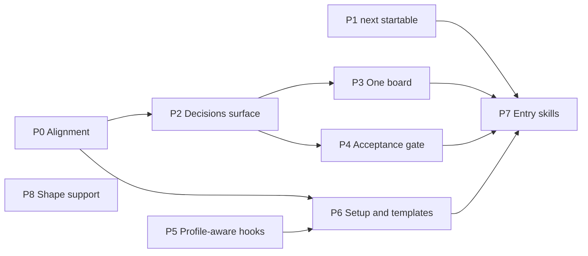

# Architecture breakdown

**Status:** Reviewed; its three decisions are settled (2026-11-24). Each package becomes items only when the owner approves materializing it. | **Date:** 2026-11-24

This document turns the settled design into work packages: what each one changes, which layer it lands in, what it depends on and in what order the packages can run. It is the bridge between the design documents in this folder and the work items that will carry the work. It is not an implementation plan: once the owner approves a package, it becomes a parent item, and its planner seat writes the plan.

Inputs: the [decision records](decisions/README.md), the server change table and shared gaps in [entry-skills.html](entry-skills.html), the real gaps and guard rails in [journey-config-fit.html](journey-config-fit.html), and the leaks in [evidence/journey-knowledge-base.md](evidence/journey-knowledge-base.md).

## Principles every package keeps

- **Interfaces follow domain objects** (work, decision, board), not skills.
- **Authority comes from the decision class and the credential.** A profile only limits how much body text a caller can read ([0003](decisions/0003-role-neutral-decisions-surface.md)).
- **The server computes the states skills keep asking about**: refined, who a decision waits on, accepted.
- **Everything a skill produces links back to its source**: a finding, a node's goal note, a ruling.
- **Method-neutral.** No package adds a method word to the tool ([0006](decisions/0006-method-words-are-schema-vocabulary.md)).
- **4.x stays additive.** Renames keep deprecated aliases until 5.0 ([0005](decisions/0005-renames-with-deprecated-aliases.md)).
- **No enforcement machinery without data.** A package instructs and reports first; it adds a gate only where a decision record says so.
- **The knowledge base keeps working.** Every package respects the 14 guard rails on the [Journey Config Fit](journey-config-fit.html) page ([0010](decisions/0010-two-domains.md)).

## Packages

Sizes are rough: S a day or less, M a few days, L a week or more of agent work.

### P0 Terminology alignment (in progress)

Running in a separate session over container `f2b1432b`: the plugin and docs sweeps, server text, run-token and run-seat renames with aliases, seat-name validation, the steering rename and the knowledge-journey glossary rows. It goes first because P2 and P6 edit the same code.

### P1 `next` returns startable work

- **Records:** [0004](decisions/0004-next-means-startable.md).
- **Layer:** server (`NextItemRecommender`, `EligibilityQuery`, the eligibility SQL), then plugin callers.
- **Contents:**
  - Phase 1: leaves only by default (`includeParents` opts out), and a `builds: false` property on a schema or trait, pinned on the item, that keeps questions and containers away from build seats. `claim` by selector shares the eligibility.
  - Phase 2: `refined` computed by the server (every required queue-phase note filled), a `refined` filter on `next` and `list`.
  - Plugin: ralph, the run-wave frontier and post-plan route 3 drop their own filtering.
- **Depends on:** nothing for phase 1. Phase 2 needs the refined storage (a filled flag on notes plus the pinned required keys).
- **Size:** M. **Risk:** low; it is the fix every caller already works around. Further `next` changes (ordering, traversal) stay held.

### P2 Decisions surface

- **Records:** [0003](decisions/0003-role-neutral-decisions-surface.md), [0005](decisions/0005-renames-with-deprecated-aliases.md).
- **Layer:** server (new tools, one additive migration), hooks.
- **Contents:**
  - `decisions_read list` and `decisions_write raise | ack | delegate | escalate | answer | withdraw`, on every profile that needs them. The `runs_*` decision ops stay as deprecated aliases.
  - `waitingOn: director | user` with `waitingReason`; status unchanged.
  - Authority from the class's `answerers` plus a credential that grants `decide` (the `director-or-human` test changes from "served on the director profile").
  - Per-class `autonomy: answer | ask`, default ask.
  - Answer provenance: `decidedBy`, `basis`, `relayed`, `withinAutonomy`, evidence links.
  - `resume` refused while the item's blocking decision is pending.
  - Hooks: `decision-guard` covers `decisions_write`; `director-watch` follows `decisions_read` and the `decision.raised` event.
- **Depends on:** P0 (server text and the run-token renames).
- **Size:** L. **Risk:** the widest tool-contract change; needs an API-compatibility review.

### P3 One board

- **Records:** the board ruling (glossary "Board"); entry-skills investigation 4.
- **Layer:** server (`report board`, every `report` select on both profiles), plugin (one board skill).
- **Contents:** a board read of ids, counts and a closed list of attention kinds (no score); one rendering shared by orchestration mode and director mode, with a way to hand work to the director. A knowledge root gets its own view (recent, untouched, orphans) and never shows as empty.
- **Depends on:** P2 for the decision inbox.
- **Size:** M-L.

### P4 Acceptance gate

- **Records:** [0008](decisions/0008-acceptance-is-a-server-gate.md).
- **Layer:** server (the gate), plugin (accept card, post-plan grant, ship step).
- **Contents:**
  - The gate, opt-in per type, as a required acceptance note satisfied only by an answered decision of a named class and option ([0012](decisions/0012-acceptance-gate-note-form.md)).
  - The conditional grant: plan approval in Auto mode records a grant; it satisfies the gate only when review passed, findings were disposed, the build is green at HEAD and no decision is open (the accept card's deterministic checks).
  - The accept mechanics skill: one card, a verbal yes or a send-back. Send-back reuses the fix cycle.
  - The ship seam: a run-profile `postRun` step with `when: accept`, running a project rule. Merge is armed only on acceptance.
- **Depends on:** P2, since the gate reads answered decisions.
- **Size:** M-L.

### P5 Profile-aware hooks

- **Records:** [0010](decisions/0010-two-domains.md) guard rails 1-3, 6, 9.
- **Layer:** plugin hooks and three skills.
- **Contents:**
  - Hooks learn which tool profile the session is connected through and name only what it serves, or stay silent: `session-start`, `orchestration-context`, the plan-mode hooks, the dispatch guard.
  - `config-sync` pushes no bundled build rules to a root whose declared types are all `lifecycle: none`, and archives the copies pushed before (done: #780, #790).
  - `create-item`, `work-summary` and `dependency-manager` stop framing a lifecycle-free root as bugs, backlog or blockers.
- **Depends on:** nothing.
- **Size:** M. **Risk:** low, and it protects real knowledge-base users today.

### P6 Setup and the template library

- **Records:** [0009](decisions/0009-setup-applies-tested-templates.md), [0010](decisions/0010-two-domains.md).
- **Layer:** plugin (the start skill, the library, CI), with config read by the plugin.
- **Contents:**
  - The start skill: check the connected profile, ask the domain, ask two to four work questions with defaults, apply one template including steering, record the template and version, register only the endpoints the domain needs.
  - The library: pre-built templates validated in CI, starting with a light template, a software template with add-ons (acceptance, review, questions and probes, delegated seats) and a knowledge-base template. Built on the ten manage-schemas profiles.
  - Upgrades: compare the recorded template and version, replace what matches a known old version, leave customised parts and report them (the bundled-rules policy).
  - `init` and `quick-start` fold into start, or call it.
- **Depends on:** P5 (the knowledge template needs profile-aware hooks) and the steering rename in P0.
- **Size:** L.

### P7 Entry skills and the helper CLI

- **Records:** the Entry Skills Design (eight skills, fate table, investigation 6).
- **Layer:** plugin.
- **Contents:** `scripts/entry.mjs` on pure libraries (scope, board, node-state, order, audit-preview, dispatch, route-decision, close-preview, config-change), read-only, rendering ops for the model to send; the entry skills shape, learn, tune, audit (user-only), board, director, accept and start at about 100 lines each; tactical skills demoted per the fate table.
- **Depends on:** P1, P2, P3, P4 and P6 for the interfaces each skill calls. Learn and tune can start earlier.
- **Size:** L.

### P8 Shape support on the server

- **Records:** entry-skills server change table.
- **Layer:** server.
- **Contents:** `create_tree` dependency edges that name existing items (with scope, lifecycle and cycle checks before any write); `derived_from` provenance links on create; `runs_write reissue` for a lost run token. A sibling `rank` stays out ([0013](decisions/0013-no-sibling-rank-yet.md)).
- **Depends on:** nothing.
- **Size:** M.

### Held until evidence asks

- Knowledge retrieval contract: notes without a phase (R36), relation words a walk follows (R38), a document-kind search filter (R49), a read of declared types on the knowledge profile, a root-wide orphan read. Wait until a knowledge user needs them.
- `next` ordering and traversal.
- Recurring work (host scheduling) and per-scope certainty (judgement, [0007](decisions/0007-certainty-is-judgement.md)).

## Order

- **Now, beside P0:** P1 phase 1, P5 and P8. None touches P0's files, and each removes a workaround or a leak on its own.
- **After P0:** P2, then P3 and P4.
- **Then:** P6, and last P7, which consumes everything else.

## Decisions settled for this breakdown (2026-11-24)

1. **The acceptance gate's form** (P4): a note satisfied by an answered decision, [0012](decisions/0012-acceptance-gate-note-form.md). The costing is below.
2. **Rank** (P8): kept out, [0013](decisions/0013-no-sibling-rank-yet.md).
3. **Where the template record lives** (P6): an `extensions.claude-code` key in the project config that the plugin reads. It is enough for setup and learn and needs no server change; a server field can follow if another harness needs to read it.

## Gate form

**Chosen: a note satisfied by an answered decision (form N),** recorded in [0012](decisions/0012-acceptance-gate-note-form.md). The alternative, a new acceptance step in the lifecycle (form L), was costed against the code on 2026-11-24.

| | Form N: note satisfied by a decision | Form L: new lifecycle step |
|---|---|---|
| Where it plugs in | One more predicate in the snapshot loader: keys satisfied by an answered decision join `filledKeys`. Start out of review, complete and every cascade already go through it. | A new `Role` value, new transition table cells, cascade rules and dependency `unblockAt` targets. |
| Production code | About 8 to 10 files: the note entry field, parser, validator, JSON schema, the fill predicate, the loader, and the places that compute "filled" for display. | `Role` appears in 65 main files; the transition types in 11 more. |
| Storage | None. The decision reader by item already exists and is indexed. | A Flyway migration rebuilding `work_items` (role CHECK constraints), the Exposed table, parity test and snapshots. |
| Goldens and plugin | Only served-schema goldens for entries that use the field; plugin hooks learn that such a note is not filled by writing a body. | About 25 golden files and over 100 plugin files and fixtures that name role strings. |
| Precedent | Independence findings and the review-pending gate are already non-body gate checks. | None. |

Evidence: `TransitionSnapshotLoader.loadDetailed` builds every gate's view; `GatePredicate.filledNoteKeys` decides "filled" from the body alone; `LifecycleStoreProvider.decisionReads().list(itemId, statuses)` is already available in the same unit and used by `AdvanceService` and `items_read context`.

**Main risk: "filled" is computed in at least five places outside the gate** (`PhaseNoteContext`, three sites in `ItemsReadContext`, `TransitionOp`). Each must move to one decision-aware function, with a test that compares what `context` reports against what `advance` allows, or `missing` and `canAdvance` will disagree with the real gate.

**Questions P4's design settles before code** (each with the lean recorded in 0012):

1. **Which answers satisfy it.** Options belong to each decision, not to the class, so a class match alone would let a "send back" answer satisfy the gate. Lean: the note entry names the class and the satisfying option keys, for example `satisfied_by: { decision_class: acceptance, options: [accept, accept-conditional] }`.
2. **A stale answer after reopen.** Notes stay filled across a reopen, so an old acceptance would satisfy the second pass. Lean: the answer must be later than the item's last reopen. That needs a reopen time the loader can read: a field on the item, or the transition events.
3. **Cancel.** Cancel skips the note gate today. Lean: keep it that way. Acceptance gates delivery, and cancelling delivers nothing.
4. **The conditional grant.** The server can check that the grant is an answered decision with a satisfying option, from the director or a human, with no other decision open on the item and the review notes filled. It cannot see a green build or disposed findings; those stay with the accept skill and the review notes, which already gate review.
5. **stdio.** A `human-only` class can never be answered there, so a gated item could never finish. Lean: the acceptance class in shipped templates is `director-or-human`, and the validator warns when a gated type names a `human-only` class.
6. **An auto parent.** An unmet gate suppresses the terminal cascade, and nothing re-fires it after the answer. Lean: the accept skill advances the node explicitly after the answer, as the orchestrator already resumes after a decision.

A separate `ACCEPTANCE` gate outside the note model would cost about the same as form N, but adds a gate concept the note model already covers.
