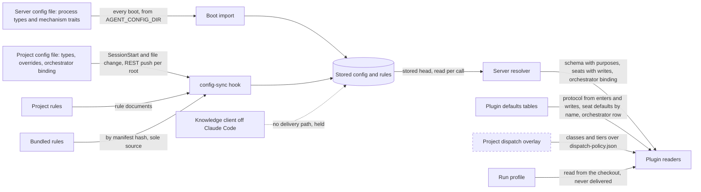

# Config layering

How configuration reaches Task Orchestrator: the server config (global floor) and each root's project config, traits and their replace rule, the plugin's defaults tables, the client files only the plugin reads, the paths each one travels, and which document owns which half of the contract. It is for contributors changing config handling, the plugin's config readers or the shipped defaults, and for agents deciding where a process change belongs. It describes origin/main at `ce75ca2a8` on 2026-11-26; each section marks what is true **today** and what is **target**. Owner decisions cited as "boundary decision N" come from the boundary analysis owner answers of 2026-11-26 (`plans/boundaries/README.md`, not tracked); where one has a record, the record is linked. Zones are those of [target-architecture.md](target-architecture.md); seams are catalogued in [seams.md](seams.md).

## The invariants

- **Runtime config is stored, never read from a file.** The server reads the stored head per call. The server config file is imported at every boot; a project config is pushed per root. Editing either file changes nothing until it is imported or pushed ([repo-architecture](../.claude/skills/repo-architecture/SKILL.md) project skill, "Config traps").
- **One precedence rule.** A specific declaration beats a generic one, and the root beats the server at the same level. The per-facet table is in [config-format.md, "How the layers combine"](../claude-plugins/task-orchestrator/skills/manage-schemas/references/config-format.md#how-the-layers-combine); this document does not copy it.
- **A trait is replaced whole.** When a root's `traits:` map names a trait, every dimension of it (notes, seats, resources, dispatch, `builds`) comes from the root's entry, and a dimension it omits is empty. So a project that overrides a server-config trait to add one line must restate the rest. This is what lets the server config ship mechanism traits safely: a project replaces one by name and never merges into it.
- **The server stores what it does not act on.** `skill`, `skill_mode`, seat `rules` and `skills`, `extensions`, and in the target note `purpose`, seat `writes` and the orchestrator binding are parsed, validated and served, never enforced by the server. The plugin is their reader.
- **Client files never reach the server.** `run-profile.json`, `tier-policy.json` and the target dispatch overlay hold local paths and client choices; the plugin reads them from the checkout.

## The two server-side layers

### Server config (global floor)

The file `deploy/global-config/.taskorchestrator/config.yaml`, mounted as `AGENT_CONFIG_DIR` and shared by every root on the server.

**Today** it holds only the process types every project gets for free (`agent-observation`, `improvement-proposal`, `session-retrospective`, `container`, `project`, `retrospective-trend`), declares no seats, and its header forbids traits. Two results:

- The traits that plugin mechanics read (`session-tracked`, `delegated`, `reviewed`, `has-carry-ins`) exist only in the dogfood config, so a project that uses only the server config has none of them. The plugin still reads their note keys by literal, and the retrospective triage then counts every scope as unclean (see [run-execution.md](run-execution.md), "Retrospective").
- `container` is `lifecycle: manual` here and `permanent` in the dogfood config, for a reason that holds for any project.

**Target** (boundary decision 19):

- The server config ships the seat-less mechanism traits, each note carrying its `purpose` ([0015](decisions/0015-note-purpose.md)): `session-tracked` (`closure-record`, an orchestrator note), `delegated` (`dispatch-provenance`, `required: false`, guidance pointing at the provenance grammar, and the agent routing for the plugin's seat agents), `reviewed` (`findings-register`, `finding-dispositions`, `fix-cycle-rulings`, without any project's skill or arbitration lines) and `has-carry-ins` (`carry-in-dispositions` for the planner's record and the orchestrator's late record). They are inert until a type names them.
- `container` becomes `permanent`.
- The header rule becomes: the server config holds the process types and the seat-less traits plugin mechanics read; project traits stay per root.
- Process-type guidance speaks of closure records and dispatch provenance, never of a project's note keys, and the retrospective method is bound to its note with `skill:` instead of described in guidance.
- `delegation-metadata` stays optional by default. On a run, the orchestrator fills it from transcripts after the seats finish; on a hand dispatch, where no generator exists, prose is the sanctioned form.

**Why only seat-less traits.** The structural checks F1-F5 run per document ([config-format.md, "Structural errors (F1-F5)"](../claude-plugins/task-orchestrator/skills/manage-schemas/references/config-format.md#structural-errors-f1-f5---reject-the-push-and-fail-the-boot-import)). A server-config trait that added a seat to a project's seats would never be checked as a union with them. A trait that only labels notes with an existing seat name, or with the orchestrator note owner, carries no such risk. Seat-adding traits such as `needs-test-author` stay shipped examples and setup templates ([0009](decisions/0009-setup-applies-tested-templates.md)).

### Project config

One root's `.taskorchestrator/config.yaml`, pushed per root and layered over the server config for that root's items. It holds the project's workflow decisions (zone Z4 Project process): its types, phases, notes and guidance, seats, traits, decision classes and `extensions.claude-code`.

**Target additions**, each parsed and served by the server, read only by the plugin:

| Field | Where | Record or document |
|---|---|---|
| `purpose` on a note entry | Schema and trait notes | [0015](decisions/0015-note-purpose.md) |
| `writes` on a seat entry (optional; default from phase) | Schema and trait seats | [0016](decisions/0016-seat-capability-and-orchestrator-notes.md), [seat-model.md](seat-model.md) |
| The orchestrator binding (`orchestrator:` with `rules`, `skills`) | Config root and traits only; a schema reaches a trait's binding through `default_traits` | [0017](decisions/0017-orchestrator-binding.md) |
| Approval routing: what plan approval sets in motion | An `extensions.claude-code` key (name set when it lands); default today's behaviour; each setup template sets it | [run-execution.md](run-execution.md), "Front door" (boundary decision 16) |

A seat named `orchestrator` or `coordinator` warns for one release and is then refused; `seat: orchestrator` on a note entry is unchanged and marks an orchestrator note ([0016](decisions/0016-seat-capability-and-orchestrator-notes.md)).

**The dogfood config in the target** (this repository's `.taskorchestrator/`): its phased `orchestrator` seat entries go; it inherits `container` and `has-carry-ins` from the server config and keeps overrides of `session-tracked`, `delegated` and `reviewed` only where it adds project lines, each override restating the `purpose` markers (a trait is replaced whole); `quick-fix` names the `session-tracked` trait instead of declaring a second closure record; its byte-identical copies of bundled rules in `.taskorchestrator/rules/` are removed (boundary decision 21), so it receives rule updates the way every other project does.

## Plugin defaults tables

Data the plugin ships (zone Z3 Shipped defaults). A project replaces each default through a declared list or a project file; it never edits the table.

| Table | Holds | Today | Target |
|---|---|---|---|
| `claude-plugins/task-orchestrator/hooks/lib/seat-rules.json` | Rule keys per seat | Rows by a role the plugin derives from seat name, phase and position; three columns (`protocol`, `pluginChosen`, `defaults`) | Two rule classes ([0018](decisions/0018-content-placement.md)): the protocol rule, chosen from the served `enters` and `writes` (including `protocol.commit` for every writing seat), and seat defaults keyed by seat name, which a declared `rules` list replaces; plus an `orchestrator` row, the defaults of the orchestrator binding. A seat whose name has no defaults row gets none. See [seat-model.md](seat-model.md) |
| `claude-plugins/task-orchestrator/hooks/lib/seat-skill-defaults.json` | Skill names per seat | Keyed by seat name | Unchanged key; a declared `skills` list replaces it |
| `claude-plugins/task-orchestrator/dispatch-policy.json` | `models` (host), `classes` (model and effort per class of work), `tiers` (sizing), `escalation` | No project seam for `classes`; one class is named `coordinator`; `tiers` replaceable through `tier-policy.json` | The `coordinator` class is renamed `orchestrator` first, with the old name accepted for one release, so no overlay is ever written against the retired word. Then a project dispatch overlay replaces `classes` and `tiers` (below) |
| `claude-plugins/task-orchestrator/bundled-rules/` with its `manifest.json` | Rule text for protocol rules and conduct defaults | Authored in this repository's `.taskorchestrator/rules/` and mirrored by a parity test | The sole source; the parity test becomes "no unintended copies" (boundary decision 21). A project copy under a bundled key still replaces it and stops receiving updates |

**Binding precedence** is a schema concept with two sources: the project's declared list, and, where the schema is silent, the plugin's table. A declared list always replaces the table; it never removes a protocol rule. The layer and concept tables that state this are in [0018](decisions/0018-content-placement.md).

## Client file seams

Files the plugin reads from the checkout beside the project config. The server never sees them.

### `run-profile.json`

One file with one reader (the run-wave snapshot), so it is split by section, not by file: its contract names the zone of every field. **Today** the contract exists only as the validator in `claude-plugins/task-orchestrator/scripts/run-planner-lib.mjs` (`validateSnapshot`, the `profile.*` checks); **target**, it is a "Run profile" section of `config-format.md`, and the code keeps validating it.

| Field | Zone | Note |
|---|---|---|
| `shell`, `verify[]` (`name`, `command`, `appliesTo`, `ownedTestsPattern`, the `<worktree>` and `<ownedTests>` placeholders), `searchScope`, `worktreeRoot`, `appendOnlyFiles`, `knownRed[]` | Z5 Project toolchain | What the project's work runs on |
| `verify[].seats` | Z4 Project process | A process binding inside a toolchain entry, documented as such |
| `branchPrefix`, `maxItems` | Z4 Project process | |
| `review.{mode, skill, onFail}` | Z4 Project process | **Target**: `review.step` is removed. Today it names a heading in project prose (`"wave.md Step 5"` in this repository), which breaks on any edit and no check sees; the named skill declares its own hand-off entry. See [run-execution.md](run-execution.md), "Review hand-off" |
| `postRun[].{step, when, rule, command, appliesTo}` | Z4 Project process | **Target** adds `skill` (the step's procedure) beside `rule` (its must-dos), at least one of the two; `step` names also become meter label classes. See [run-execution.md](run-execution.md), "Post-run steps" |

### Project dispatch overlay and `tier-policy.json`

**Today** `.taskorchestrator/tier-policy.json` (`thresholds`, `rows`, `forceUp`, `forceDown`) overrides `dispatch-policy.json` `tiers`, read by `claude-plugins/task-orchestrator/scripts/tier-policy.mjs` from beside a project-scope config only; it is undocumented, and this repository has none. A project cannot change a dispatch class at all.

**Target** (boundary decision 22, after the class rename): one project client file, documented in `config-format.md`, carries the project's `classes` and `tiers` over the plugin's `dispatch-policy.json`. `tier-policy.json` folds into it and is read as a deprecated alias. A seat's own model and effort still come first from a trait's `dispatch.<phase>.seats.<seat>` entry, which is server config, not this file.

## Delivery paths

| Path | Carries | Takes effect | Today | Target |
|---|---|---|---|---|
| **Boot import** (`server-config-import` data step, `ServerConfigImportStep`) | The server config file under `AGENT_CONFIG_DIR` | At every boot; a restart reloads it | Process types only | Also the purpose-marked mechanism traits |
| **Per-root push by `config-sync`** (`claude-plugins/task-orchestrator/hooks/config-sync.mjs`, on SessionStart and on a change to `config.yaml`) | The located project config (or the user-level config of a personal root); the project's `rules/*.md`; on SessionStart, the bundled rules by manifest hash | Immediately; a push hot-reloads | Over the REST API (`validate`, then `push` with `expectedVersion`); a no-op when no REST URL is configured; a lifecycle-free root gets no bundled rules | Unchanged path; the bundled rules are the only source of their text |
| **`config` `push` by hand** (`config` tool or `POST /api/v1/ops/config`) | Any per-root document | Immediately | Strict: a document with any error is refused whole | Unchanged |
| **Knowledge profile off Claude Code** | Would carry a knowledge root's config | n/a | No path: the `config` tool's ops are on the orchestration profile only (for example `ConfigPushOp.kt:41`), and only the Claude Code hook pushes over REST | Held, kept free of `config` by the knowledge-profile guard rails. Reopen when a knowledge-profile connection whose MCP `initialize` client name is not Claude Code shows in server logs or a user report (pass 10 decision G11); meanwhile a REST push, documented by configure-server, is the workaround |
| **Client files** | `run-profile.json`, `tier-policy.json`, the target dispatch overlay | On the next plugin read | Read from the checkout | Unchanged |

The diagram shows the target. The server config's mechanism traits, the `purpose` and `writes` fields, the orchestrator binding and the dispatch overlay (dashed) are not built yet; the remaining nodes and edges are today's.

## Who owns the contract

Two documents claim the config contract today: [current/docs/config-reference.md](../current/docs/config-reference.md) opens as "the canonical description of a Task Orchestrator config document", and [config-format.md](../claude-plugins/task-orchestrator/skills/manage-schemas/references/config-format.md) covers the same keys from the plugin side. The real authority is the parity-tested key catalog plus `config.schema.json`. The target split (boundary decision 24):

| Document | Owns |
|---|---|
| `current/docs/config-reference.md` | What the server parses, validates and serves: key ownership by layer, strict validation and parse modes, the published values of `purpose`, the served shape of `writes` and the orchestrator binding |
| `config-format.md` | How the plugin reads config: what each `purpose` value's consumer does and what happens when no note carries it, the defaults tables and the two rule classes, authoring guidance, and the client-file sections (run profile, dispatch overlay with the `tier-policy.json` alias) |

**Today's overlap to cut:** the "Seat rules" section of `config-reference.md` restates the plugin's three rule classes; it becomes a pointer to `config-format.md`.

## Traps

- **A trait override drops what it does not restate.** A project override of a server-config mechanism trait that omits the `purpose` marker turns that mechanism off for its types (after the one-release fallback, see [0015](decisions/0015-note-purpose.md)).
- **No server config mounted.** `configure-server` allows running without the mount. Then no mechanism trait exists unless the project declares one, and every purpose-driven mechanism reports itself off rather than guessing.
- **The dogfood config is not the server config.** This repository's `.taskorchestrator/config.yaml` is pushed per root by `config-sync` and never mounted; the server config is `deploy/global-config/.taskorchestrator/`.
