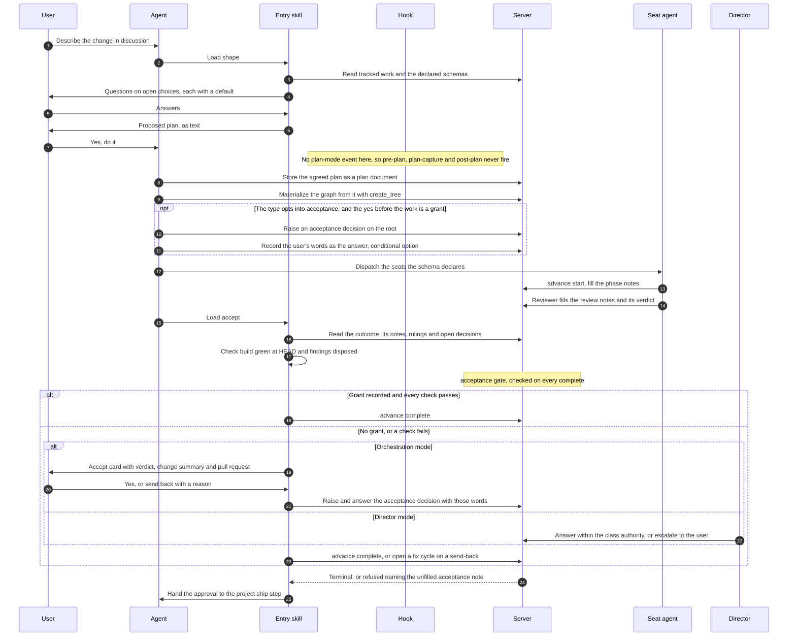
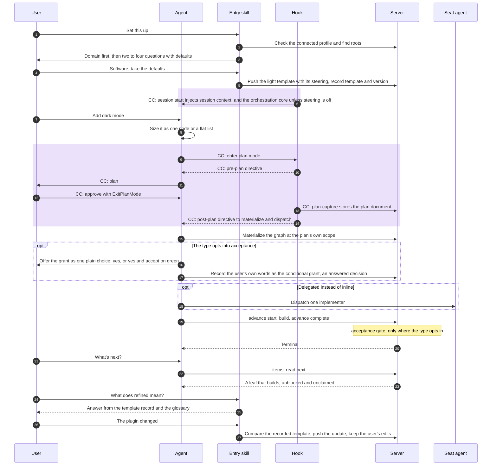
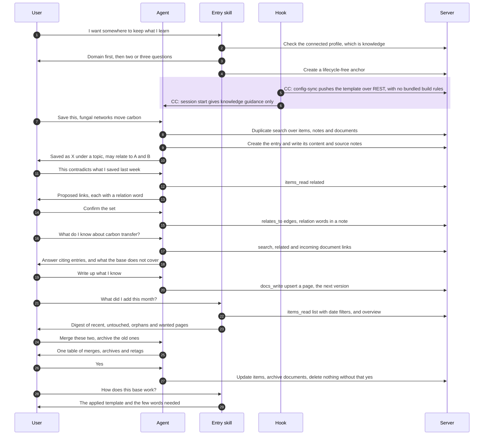
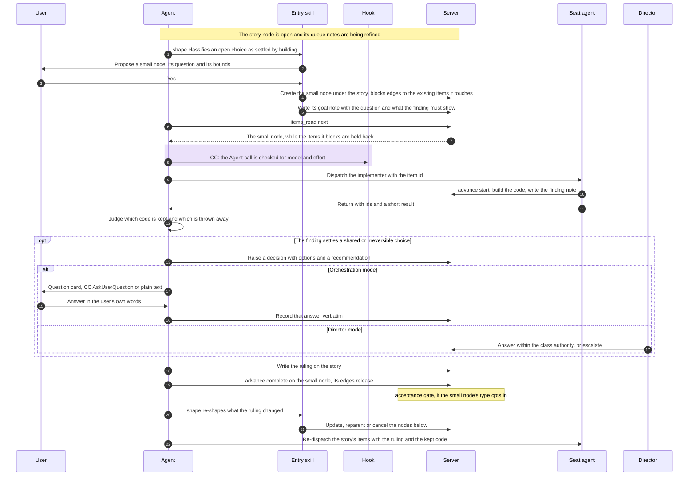

# Journey sequences

Sequence diagrams for four user journeys, used to test one thing: does every step have exactly one owning layer? Each journey has a diagram, the steps whose owner is missing, ambiguous or split, and a table of what exists today against what the design adds. A cross-journey section closes the document.

**Graded against the target (2026-11-26).** These diagrams show today's lanes. The same steps are walked against the target architecture ([target-architecture.md](target-architecture.md)) in [journey-overlay.md](journey-overlay.md), which grades each step fits, gap or leak and keeps the open ones as a burn-down list. Where this document names an owner as missing, the overlay says which decision or work package now supplies it, or that it is still open.

Terms follow [GLOSSARY.md](../GLOSSARY.md). Layers and concepts follow [0018](decisions/0018-content-placement.md) (plugin mechanics, engineering skills, bundled rules, project config, project skills; and mechanics skill, engineering skill, rule, schema, hook, server). Moments, journeys and stages follow the [Strategic Journey Map](user-journey-map.html); entry skills follow [Entry Skills Design](entry-skills.html). Settled choices are in [decisions/](decisions/README.md); this document links to them and does not restate them.

The acceptance gate appears as one box in every diagram. Its states are modelled in [acceptance-gate-states.md](acceptance-gate-states.md).

## How to read the diagrams

- **Lanes.** User; Agent (the main session: the orchestrator in orchestration mode, or a background orchestrator in director mode); Entry skill (a user-facing mechanics skill, such as shape, accept, start, board or learn); Hook; Server; Seat agent (planner, implementer, reviewer); Director, only where a journey uses one.
- **Harness-specific steps** sit inside a shaded box and their text starts with `CC:`. They depend on Claude Code: hooks, plan mode, permission modes or `AskUserQuestion`. Every unshaded step is harness-neutral; one that has a Claude Code form and a plain form names both in its text.
- **Step numbers** are the diagram's own numbers; the lists below each diagram cite them.
- **Owner concept** in the tables is one of: mechanics skill, engineering skill, rule, schema, hook, server, or judgement (the user's or the agent's, held in conversation, per [0007](decisions/0007-certainty-is-judgement.md)).

## Citations

`PLUG` is `claude-plugins/task-orchestrator/`. `KT` is `current/src/main/kotlin/io/github/jpicklyk/mcptask/current/`. Line numbers were taken at main `256b2bd34`; every `KT` path, and the `PLUG` lines that had moved, were re-checked against `ce75ca2a8` on 2026-11-26 (the item and lifecycle code now sits in the `itemwrite` and `lifecycle` slices). They go stale as the code moves. Design pages are cited by file and line of their source HTML.

Some leaks recorded in [evidence/journey-knowledge-base.md](evidence/journey-knowledge-base.md) (KL5, KL9 to KL12, KL16, KL17) were fixed after that file's commit. The tables below cite today's code, not the evidence file.

---

## 1. Plan acceptance on a harness without plan mode

**Confirmed against the map.** The map has no journey of this name. It is stage 7.3 "Agree the plan" of Light touch (`design/user-journey-map.html:365`) and the Accept stages 2.5 and 6.8, run on a harness that has no plan mode, as [0008](decisions/0008-acceptance-is-a-server-gate.md) requires ("a skill on a harness with no plan mode"). The user and the agent agree a plan in discussion, the plan is materialized into items, and acceptance is a server gate ([0012](decisions/0012-acceptance-gate-note-form.md)).

### Owner missing, ambiguous or split

- **Steps 2 to 6: no trigger for the plan (owner missing).** Today only the plan-mode hook reaches the definition floor. In the design shape owns planning, but its card sends a single known change "to plan mode or straight to the agent". With no plan mode, nothing says who writes a plan for one known change.
- **Step 7: a plain yes has two meanings (ambiguous).** It agrees the plan, and in Auto mode it also grants acceptance in advance (map gap "Plan approval carries two meanings", `design/user-journey-map.html:429`). The design reads the grant from Claude Code's `permission_mode` in a hook (entry-skills call 11, `design/entry-skills.html:394`). This harness has neither, so no lane decides whether the yes is a grant. Under 0007 it would be judgement, with its outcome recorded; no document says so for this case. Settled 2026-11-26 (pass 10 decision G1; [0008](decisions/0008-acceptance-is-a-server-gate.md), [0012](decisions/0012-acceptance-gate-note-form.md), amended): a grant counts only when the user's own words say so, on every host, and the orchestrator records those words; a plain yes agrees the plan and grants nothing.
- **Step 8: storing the plan (owner missing).** A Claude Code hook stores it today. No skill owns it on another harness, so materialization falls back to the plan text in context.
- **Steps 10, 11 and 21: who records the acceptance decision (split).** Call 11 has post-plan record the grant; the accept card records the verdict. Both are relays of the user's words, which the orchestrator may do in orchestration mode. Today no orchestration-profile tool can record an answer.
- **Step 17: the grant's conditions (split across Entry skill and Server).** The server can check an answered decision, no other open decision and filled review notes. Build green at HEAD and disposed findings are checked only by the accept skill ([architecture-breakdown.md](architecture-breakdown.md), "Gate form", question 4). A client that calls `advance complete` without the skill passes the gate on a red build. In the target the accept skill raises the acceptance decision with these claims as its evidence, and the gate checks that the answered decision carries them ([0012](decisions/0012-acceptance-gate-note-form.md)); that records the claims, it does not prove the build.
- **Steps 18, 21 and 23: an open-run member needs the run token (J-F1).** When the accepted item is a member of an open run on a seat-aware type, the server refuses the user's own session: its `advance` gets `seat_forbidden` (`KT/lifecycle/TransitionPolicy.kt:122-124`) and its write of the acceptance note gets `note_owned_by_other`, since only the run token may write an orchestrator note there (`KT/note/internal/domain/NoteSeatRule.kt:40`, `:61`). The human exemption needs a credential of kind `human`; stdio, local HTTP and `API_AUTH_MODE=none` run as the local principal, of kind `agent` (`KT/platform/call/LocalPrincipal.kt:5-19`). No lane in the diagram passes the token today. In the target the accept skill uses the run token from the run files, or hands the step to the run's orchestrator, and the refusals carry a `fixArgs` hint naming the run ([0016](decisions/0016-seat-capability-and-orchestrator-notes.md)); in director mode the step goes to the run's orchestrator.
- **Step 25: the ship step (owner missing).** How accept hands approval to the project's ship step without naming a project skill is still open (`design/entry-skills.html:418`).

### Today versus the design

| Steps | Lane | Owner concept | Today | The design adds |
|---|---|---|---|---|
| 2-6 | Entry skill | mechanics skill | Only via plan mode: `PLUG/hooks/pre-plan.mjs:2,28-36` orders `pre-plan-workflow`, which is internal and hook-triggered (`PLUG/skills/pre-plan-workflow/SKILL.md:3-4`) | shape reads the schema and asks (`design/entry-skills.html:444-447`) |
| 7 | User, Agent | judgement | No event: `post-plan.mjs` fires on `ExitPlanMode` only (`PLUG/hooks/hooks-config.json:140`; `PLUG/hooks/post-plan.mjs:2`) | 0008: a skill satisfies the gate on a harness without plan mode |
| 8 | Agent | none named | `PLUG/hooks/plan-capture.mjs:1-5` (Claude Code hook over REST); fallback to the plan text in context (`PLUG/skills/post-plan-workflow/SKILL.md:21`) | nothing |
| 9 | Server | server | `create_tree` with `docRef` (`PLUG/skills/post-plan-workflow/SKILL.md:23-29`), orchestration only (`KT/itemwrite/internal/wire/CreateTreeOp.kt:63`) | shape renders one `create_tree` (entry-skills investigation 6) |
| 10-11, 20-22 | Agent, User, Director | server (class and credential) | `raise` is orchestration (`KT/run/internal/wire/RunsRaiseOp.kt:51`); `answer` is director only (`KT/run/internal/wire/RunsAnswerOp.kt:28`) | role-neutral `decisions_write` with `decidedBy` and `relayed` (P2, [0003](decisions/0003-role-neutral-decisions-surface.md)); the grant as an answered decision (0012) |
| 12-14 | Seat agent | schema, server | post-plan routes to run-wave or hand-dispatch (`PLUG/skills/post-plan-workflow/SKILL.md:63-101`) | unchanged |
| 15-17 | Entry skill | mechanics skill | No accept skill | the accept card and its checks (`design/entry-skills.html:464`; architecture P4) |
| 18, 23-24 | Server | server | No acceptance gate (architecture P4 not started); on an open-run member, a token-less accept is refused (J-F1, `KT/lifecycle/TransitionPolicy.kt:122-124`) | a required note filled only by an answered decision carrying the claims as evidence (0012); the accept skill acts with the run token on a run member (0016) |
| 25 | Entry skill | open | `postRun` `when` is `post-run` or `post-merge` only (`PLUG/scripts/run-planner-lib.mjs:104`) | `when: accept` (architecture P4); the hand-off is open |

---

## 2. Light touch

**Confirmed against the map.** Journey "Light touch" (`design/user-journey-map.html:360-368`), stages 7.1 to 7.6: a vibe-coding user, one node or a flat list, certainty not considered, Auto mode. The user wants almost no machinery.

### Owner missing, ambiguous or split

- **Step 5: who sets steering (conflict between today and the design).** [0009](decisions/0009-setup-applies-tested-templates.md) makes steering part of the template. Today init must not write the `extensions` block, and an absent key means `workflow`. A light user therefore gets the workflow core: sizing tiers and "Materialize before implement".
- **Step 8: who sizes (ambiguous).** Sizing tiers live in the orchestrate mechanics skill, which only hook text points to, and only under `workflow` steering. Under `schema` or `off` steering nothing names who sizes. The journey wants the agent to size by judgement; no document says so.
- **Steps 12 to 15: what approval sets in motion (owner is hook text, not config).** Approval always means materialize and dispatch, and two or more unblocked leaves route to run-wave (config-fit gap 4, R14). A light project cannot say "materialize only" or "build inline".
- **Steps 16 and 17: the grant (settled 2026-11-26).** The first design split it across Hook and Agent: a hook read the permission mode and the agent recorded the grant. Now the agent offers the grant as one plain choice and records the user's own words as the answer; no hook reads the mode, so both steps are harness-neutral (pass 10 decision G1; [0008](decisions/0008-acceptance-is-a-server-gate.md), [0012](decisions/0012-acceptance-gate-note-form.md), amended). The lightest template declares no gated type, so the opt never runs there, and an ungated type's merge is armed by the project's own merge step, as today ([0008](decisions/0008-acceptance-is-a-server-gate.md), amended).
- **Steps 21 to 23: which next (owner missing).** Stage 7.4 wants next in the graph, next by rank, or breadth- or depth-first. The server has one meaning, the build-seat one. The other meanings have no owner (see the ADR conflicts below).
- **Steps 24 and 25: the glossary (owner missing).** learn explains from the glossary, but the glossary is a repo file that no tool serves (`design/entry-skills.html:511`). Settled 2026-11-26: learn fetches the glossary, docs and design from GitHub at the installed version, plus the user's served schema and config ([0019](decisions/0019-learn-reads-upstream-sources.md)).
- **Steps 26 and 27: the template record (owner missing).** Nothing reads it yet (R46). The record's place is settled (an `extensions.claude-code` key, architecture decision 3); its reader is not built.

### Today versus the design

| Steps | Lane | Owner concept | Today | The design adds |
|---|---|---|---|---|
| 1-5 | Entry skill | mechanics skill | init verifies with `context` and `runs_read` (`PLUG/skills/init/SKILL.md:35-43`); must not write `extensions` (`:190-194`); default steering `workflow` (`PLUG/hooks/orchestration-lib.mjs:18`); no light template (R21) | start applies one light template with steering and records it (0009, architecture P6) |
| 6 | Hook | hook | workflow core with tiers and "Materialize before implement" (`PLUG/hooks/orchestration-context.mjs:66-78,140-141`) | the template's steering decides what is injected |
| 8 | Agent | judgement or mechanics skill | tiers named by hook text (`PLUG/hooks/orchestration-context.mjs:66`) | nothing |
| 9-14 | Hook | hook | `PLUG/hooks/pre-plan.mjs:28-36`, `PLUG/hooks/plan-capture.mjs:1-5`, `PLUG/hooks/post-plan.mjs:28-36` | unchanged |
| 15 | Agent | mechanics skill | post-plan materializes, then routes to run-wave or hand-dispatch (`PLUG/skills/post-plan-workflow/SKILL.md:11-85`) | approval materializes at the plan's own scope (stage 7.3) |
| 16-17 | Agent, User | judgement, server | No grant: `permission_mode` appears in the plugin only in orchestrator placement (`PLUG/scripts/coordinator-tiers.mjs:84,109`) | the grant offered as a plain choice and recorded in the user's own words as an answered decision, on every host (0008, 0012, amended) |
| 18-20 | Agent, Seat agent, Server | server | the advance gates; a light type with no review notes goes straight to terminal | unchanged |
| 21-23 | Server | server | `next` returns a queued leaf that builds, unclaimed, with no unsatisfied blocker (`KT/lifecycle/internal/wire/ItemsReadNext.kt:106-109`) | `refined` filter (0004 phase 2) |
| 24-25 | Entry skill | mechanics skill | No learn skill | learn (architecture P7) |
| 26-27 | Entry skill | mechanics skill | Nothing records the template (R22, R46) | start compares the recorded template (architecture P6) |

---

## 3. Keep a knowledge base

**Confirmed against the map.** Journey "Keep a knowledge base" (`design/user-journey-map.html:369-379`), stages 8.1 to 8.8, on the knowledge tool profile. Items are lifecycle-free, so there is no `advance`, no run, no seat and no director ([0010](decisions/0010-two-domains.md)). The knowledge profile serves item reads and writes, notes, dependency edges and documents; `advance`, `config`, `runs_*`, `report`, `context` and `next` are orchestration or director only (`KT/platform/tool/ToolProfile.kt:58-65`; for example `KT/lifecycle/internal/wire/TransitionOp.kt:58`, `KT/config/internal/wire/ConfigPushOp.kt:41`).

### Owner missing, ambiguous or split

- **Steps 1 to 4: setup (owner missing).** start does not exist. init stops or misreports on this connection, never registers the knowledge entry, and creates the anchor as the floor's role-bearing type (KL1 to KL3).
- **Step 5: config delivery (harness-specific, no neutral owner).** The `config` tool is not served on this profile, so a Claude Code hook pushes config over REST. On another harness no lane owns config delivery, and no in-session validate exists anywhere.
- **Steps 7 to 10: capture (ambiguous).** The routing table sends setup phrases to start and "how does this base work" to learn, but "save this" to no entry skill (`design/entry-skills.html:485`). create-item becomes internal, called by shape and by the agent, and shape triggers on product work. So capture is an internal mechanics skill picked by the agent's judgement. Its lifecycle-free branch detects the root with an orchestration-only read or a local file, and the agent cannot list the root's declared types on this profile (KL20).
- **Steps 13 to 15: the relation word (split across Agent and Server).** The word lives in note text that the agent writes; the edge the server records is `relates_to` with no kind, and the graph walk ignores it (R38, held).
- **Steps 19 and 20: the synthesis method (owner missing).** A note's `skill:` can bind a method, but a page has no schema to bind one to (R48). An engineering skill for synthesis has no seat or note to reach.
- **Steps 21 to 23: revisit (server owner missing).** The knowledge view is part of the one board in the design. Orphans and wanted pages have no root-wide read (KL28, held).
- **Steps 24 to 27: prune (owner missing).** No entry skill covers it: tune changes the process and shape the product. Items have no archive and delete is permanent (evidence stage 8.7). "Nothing deletes without a yes" rests on the agent's conduct alone; with no seats, no rule can be bound to it.
- **Steps 28 and 29: learn (owner missing).** No learn skill, and nothing reads the template record (R46).

### Today versus the design

| Steps | Lane | Owner concept | Today | The design adds |
|---|---|---|---|---|
| 1-4 | Entry skill | mechanics skill | init reads `context` and requires `runs_read` (`PLUG/skills/init/SKILL.md:35-43`), both absent here (`KT/lifecycle/internal/wire/ItemsReadContext.kt:99`); the registration library knows the knowledge URL (`PLUG/hooks/lib/mcp-registrations.mjs:121`), init does not | start checks the profile and applies the knowledge template (0009, architecture P6) |
| 5 | Hook | hook | config-sync over REST, and no bundled rules for a lifecycle-free root (`PLUG/hooks/config-sync.mjs:6-8,786`) | unchanged |
| 6 | Hook | hook | knowledge guidance (`PLUG/hooks/session-start.mjs:33-37,318-328`); the orchestration core, plan hooks and dispatch guard stay silent (`PLUG/hooks/orchestration-context.mjs:159`; `PLUG/hooks/pre-plan.mjs:16`; `PLUG/hooks/post-plan.mjs:16`; `PLUG/hooks/dispatch-model-guard.mjs:50`), all keyed on `isKnowledgeSession` (`PLUG/hooks/lib/session-profile.mjs:77-89`) | profile-aware hooks finished (architecture P5) |
| 7-10 | Agent | mechanics skill (internal) | create-item's lifecycle-free branch (`PLUG/skills/create-item/SKILL.md:15-22`); search over all kinds (`KT/knowledge/internal/wire/ItemsReadSearch.kt:67`) | capture follows the applied template's types (map gap, `design/user-journey-map.html:425`) |
| 11-15 | Agent, Server | server | `related` (`KT/knowledge/internal/wire/ItemsReadRelated.kt:55`); `deps_write` on knowledge (`KT/dependency/internal/wire/DepsCreateOps.kt:50`) | relation words held (R38) |
| 16-18 | Agent | judgement | search, related and document links; no skill (evidence stage 8.4, rated good) | unchanged |
| 19-20 | Agent, Server | server | `docs_write` on knowledge (`KT/knowledge/internal/wire/DocsWriteOps.kt:28`) | unchanged |
| 21-23 | Entry skill | mechanics skill | work-summary renders an inventory for a lifecycle-free root (`PLUG/skills/work-summary/SKILL.md:19-21`) | a knowledge view in the one board (architecture P3) |
| 24-27 | Agent | judgement | `items_write` update and delete, `docs_write` archive (evidence stage 8.7) | nothing |
| 28-29 | Entry skill | mechanics skill | No learn skill | learn explains the template (architecture P7) |

---

## 4. Build to learn

**Confirmed against the map.** Stage 6.4 "Build to learn" of journey "Incremental delivery" (`design/user-journey-map.html:348-358`): a small node runs Intend, Decide and Accept inside a story node; its finding settles a question and can reshape, reparent or cancel the nodes below; the agent judges which of its code is kept. A spike is not a type: it is a small node run through the same moments (`design/user-journey-map.html:443`).

### Owner missing, ambiguous or split

- **Step 1: ask, research or build (split).** The method that classifies a choice is in planning-standards, an engineering skill bound to the planner seat (`design/user-journey-map.html:448`). shape runs in the main session, which no seat binding reaches. So the method is bound to one lane and the step runs in another.
- **Step 12: keep or throw (owner and record missing).** The map says "the agent judges". It needs reading a diff, which the director may not do, so in director mode it falls to a background orchestrator. It is engineering judgement, but no engineering skill holds it. 0007 says such an outcome must be recorded, and no note holds it. How thrown code leaves a shared feature branch is a project rule (this project forbids rebase), and no rule names it. Settled 2026-11-26 (pass 10 decision G4): the building seat records the kept and thrown commits in its `finding` note, guided by a short `implementation-standards` section; the orchestrator reads the finding as a pointer and writes the `ruling`, so director mode needs no diff read; a project rule says how thrown code leaves the branch.
- **Steps 13 to 17: build to learn has two owners in the design.** The small node is driven by the orchestrator and built by seats. The director card also "sends a background research or prototype agent" (`design/entry-skills.html:459`; map "Inside Decide", `design/user-journey-map.html:201`). Two paths settle a question by building, with no line between them.
- **Step 18: who writes the ruling (ambiguous).** For a planned question, the design says answering "writes the ruling note and completes the item" (`design/entry-skills.html:187`), without saying whether the server or a skill writes it. `answer` takes no links, so the ruling cannot be tied to its decision (`design/entry-skills.html:562`).
- **Step 19: whose verdict closes the small node (ambiguous).** Acceptance is the user's verdict (glossary "Acceptance"); the keep-or-throw call is the agent's. Nothing orders the two, or says whether the user accepts a finding at all.
- **Step 22: resume while the decision is pending (server gate missing).** The server does not refuse `resume` while the item's blocking decision is pending: `resume` is checked only for the blocked role and a restorable previous role (`KT/lifecycle/internal/domain/TransitionTable.kt:106-110`, refusal messages at `KT/lifecycle/AdvanceService.kt:943-950`), and the gate set has no decision gate (`KT/lifecycle/Decision.kt:10`). Only hook prose tells the orchestrator to wait (`PLUG/hooks/orchestration-context.mjs:46`). [0003](decisions/0003-role-neutral-decisions-surface.md) accepts the refusal; architecture P2 carries it.
- **Steps 20 and 21: stale rulings (owner missing).** Reopen works only from terminal and nothing flags items built on a ruling that later changed (map gap, `design/user-journey-map.html:410`). Settled 2026-11-26 (pass 10 decision G5): shape re-walks the ruling node's subtree and the `linked_from` hits of `items_read` `related`, and the user confirms the candidates; a dedicated read follows only an observed miss.

### Today versus the design

| Steps | Lane | Owner concept | Today | The design adds |
|---|---|---|---|---|
| 1-3 | Entry skill | mechanics skill, engineering skill | decomposing-work names a spike as a PR boundary reason (`PLUG/skills/decomposing-work/SKILL.md:25`); no shape skill | shape classifies each choice (`design/entry-skills.html:444`) |
| 4 | Server | server | `create_tree` deps may name existing items (`KT/itemwrite/internal/wire/CreateTreeOp.kt:49-50`, #787) | `derived_from` on create (architecture P8) |
| 5 | Entry skill | schema | a type with a required work note and no review notes is expressible (R6); no incremental-delivery profile ships (`PLUG/skills/manage-schemas/references/profiles/`) | the profile, with "no production code in a spike" as a project rule (`design/user-journey-map.html:447`) |
| 6-7 | Server | server | leaf rule and `builds` (`KT/lifecycle/internal/wire/ItemsReadNext.kt:106-109`; `KT/model/schema/WorkItemSchema.kt:33`) | `refined` filter (0004 phase 2) |
| 8 | Hook | hook | `PLUG/hooks/dispatch-model-guard.mjs:5-12` | unchanged |
| 9-11 | Seat agent | schema, server | hand-dispatch or run-wave (`PLUG/skills/post-plan-workflow/SKILL.md:87-99`) | unchanged |
| 12 | Agent | none named | nothing | nothing |
| 13 | Agent | server | `raise` on orchestration (`KT/run/internal/wire/RunsRaiseOp.kt:51`) | `decisions_write` (P2) |
| 14-17 | User, Director | server (class and credential) | `answer` director only (`KT/run/internal/wire/RunsAnswerOp.kt:28`); a subagent is denied `answer` (`PLUG/hooks/decision-guard.mjs:2-4`) | answer on every profile that needs it, with provenance (P2) |
| 18 | Agent | ambiguous | a note write; no link to the decision | evidence links on an answer (P2) |
| 19 | Server | server | the advance gates; no acceptance gate | 0012 where the type opts in |
| 20-21 | Entry skill | mechanics skill | reparent by `items_write` update, cancel by `complete_tree`; reopen only from terminal (`KT/lifecycle/AdvanceService.kt:952`) | shape re-shapes after a ruling |
| 22 | Agent | mechanics skill | the orchestrator resumes an item held by the decision before re-dispatch (`PLUG/hooks/orchestration-context.mjs:46`); the server refuses resume on role and previous role only, never on an open decision (`KT/lifecycle/AdvanceService.kt:943-950`; no decision gate in `KT/lifecycle/Decision.kt:10`) | resume refused while a decision is pending (P2) |

---

## Across the journeys

### Gaps in more than one journey

1. **No orchestration-profile tool records an answer** (journey 1 steps 10-11 and 21, journey 2 step 17, journey 4 step 16). `answer`, `ack` and the decision reads are director only (`KT/run/internal/wire/RunsAnswerOp.kt:28`, `RunsAckOp.kt:27`, `RunsDecisionsSelect.kt:28`). The relay that orchestration mode allows has no tool until P2 lands.
2. **Approval and the grant depend on Claude Code events** (journey 1 steps 2-8, journey 2 steps 9-16). Plan-mode hooks start planning and materialization, a hook stores the plan, and the first design read the grant from the permission mode. On another harness the plan store and the grant signal have no owner. Since 2026-11-26 the grant depends on no host: it is the user's own words, recorded by the orchestrator (pass 10 decision G1).
3. **The grant's conditions are split between the accept skill and the server** (journey 1 step 17, journey 2 step 17). Build green at HEAD and disposed findings are skill-only checks, so the gate alone does not hold them.
4. **Setup, the template record and config delivery** (journey 2 steps 1-5 and 26-27, journey 3 steps 1-5 and 28-29). start does not exist, nothing reads the template record, and a knowledge root gets its config only through a Claude Code hook.
5. **No one serves the glossary** (journey 2 steps 24-25, journey 3 steps 28-29). learn explains from a repo file no tool returns. Settled by [0019](decisions/0019-learn-reads-upstream-sources.md): learn fetches it upstream at the installed version.
6. **Judgements with no record** (journey 1 step 7, journey 2 step 8, journey 4 step 12). Whether a yes is a grant, how big the work is, and which code is kept are judgement under 0007, which requires the outcome be recorded. No note key or field is named for any of them.
7. **Moments reached by no entry skill** (journey 3 capture and prune, journey 4 the ask-research-build split). Each runs through an internal skill, or none, chosen by the agent's judgement, and the routing table names no owner.
8. **What follows acceptance** (journey 1 step 25, journey 2 for an ungated type). The ship step is open, and merge arming depends on an acceptance a type may not declare.

### Conflicts with accepted decision records

Named here, not resolved.

- **[0004](decisions/0004-next-means-startable.md) and [0013](decisions/0013-no-sibling-rank-yet.md) against Light touch stage 7.4.** The stage wants next in the graph, next by rank, or breadth- or depth-first (`design/user-journey-map.html:366`). 0004 holds further `next` changes, and 0013 builds no rank.
- **[0008](decisions/0008-acceptance-is-a-server-gate.md) against itself on a light template.** Acceptance is opt-in per type, and merge is armed only on acceptance. The lightest template declares no gated type, so its merge is never armed (journey 2 steps 16-17).
- **[0008](decisions/0008-acceptance-is-a-server-gate.md) against entry-skills call 11.** 0008 says every surface satisfies the gate the same way. Call 11 reads the Auto-mode grant from Claude Code's `permission_mode` in a hook, which no other harness has (journey 1 step 7). [0012](decisions/0012-acceptance-gate-note-form.md) makes the grant an answered decision but does not say who records it there. Resolved 2026-11-26 in both records (pass 10 decision G1): the grant counts only in the user's own words on every host, the orchestrator records them, and call 11 no longer reads `permission_mode`.
- **[0002](decisions/0002-director-on-orchestrator-tools.md) against today's code (resolved in the record).** 0002 said director mode runs on the orchestration connection, but `answer`, `ack`, `pause`, `resume` and the decision reads are served on the director profile only (`KT/run/internal/wire/RunsAnswerOp.kt:28`, `RunsAckOp.kt:27`, `RunsPauseOp.kt:26`, `RunsResumeOp.kt:26`, `RunsDecisionsSelect.kt:28`). 0002 now describes two connections as the interim state, with [0003](decisions/0003-role-neutral-decisions-surface.md) as the destination: until P2, a director-mode session answers over the director profile (journey 1 step 22, journey 4 step 17).
- **[0001](decisions/0001-two-session-layers.md) against the director's prototype agent.** 0001 says the director never drives. The director card and the map have it send a prototype agent that builds code to settle a decision (journey 4 steps 13-17).
