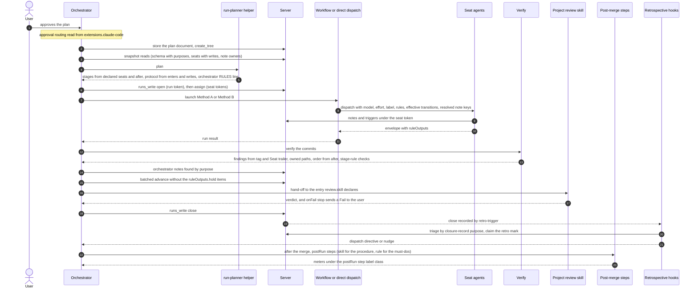

# Run execution

How a run goes from plan approval to the retrospective: approval routing, the run plan and its stages, dispatch, verify, the review hand-off, the post-run steps, the rule outputs (`ruleOutputs`, including `hold`), declared post-merge steps with `postRun[].skill`, meter label classes, and the retrospective trigger. It is for contributors changing `run-wave`, its scripts or its workflow, and for agents running a wave who need to know which part of a run is mechanics and which part is the project's process. It describes origin/main at `ce75ca2a8` on 2026-11-26; each section marks what is true **today** and what is **target**. Owner decisions cited as "boundary decision N" come from the boundary analysis owner answers of 2026-11-26 (`plans/boundaries/README.md`, not tracked). Config fields named here are placed in [config-layering.md](config-layering.md); seat facts in [seat-model.md](seat-model.md); the checks in [enforcement-map.md](enforcement-map.md).

## The rule this document holds to

A run's mechanics belong to the plugin (zone Z2 Plugin mechanics): opening the run, ordering stages, dispatching, verifying, closing, metering. Everything a project could choose differently belongs to the project's config: which notes exist and which does which job (`purpose`, [0015](decisions/0015-note-purpose.md)), which seats write and in what order (`writes`, `after`), which rules bind the orchestrator ([0017](decisions/0017-orchestrator-binding.md)), how review and post-merge work is done (`run-profile.json`). **Today** the plugin still decides several of those itself; each section below names where. **Target**: the plugin decides only from facts the server serves or the project declares, and a fact the project did not declare turns the mechanism off and is reported, never guessed.

## Front door and approval routing

What plan approval sets in motion is a process choice. **Today** plugin text makes it: `claude-plugins/task-orchestrator/skills/post-plan-workflow/SKILL.md:9` calls approval "the green light for the full pipeline" and runs every phase without stopping, so a light project cannot choose to only record the items.

**Target** (boundary decision 16): an `extensions.claude-code` key (name set when it lands) says what approval sets in motion: materialize the items only, materialize and build inline, or materialize and dispatch. Its default is today's behaviour, and each setup template sets it ([0009](decisions/0009-setup-applies-tested-templates.md)). The post-plan hook and skill read it. Also target (boundary decision 26): the skill that agreed the plan stores it as a plan document before `create_tree` on every host; plan mode stays the fast path on Claude Code.

`run-wave` is the front door for a wave over items whose queue notes exist (its Steps table, `claude-plugins/task-orchestrator/skills/run-wave/SKILL.md`, "Steps 1-9"): scope, snapshot, plan, worktrees, open, assign, launch, post-run, review, post-merge steps, feature closure, loop.

## Plan and stages

The `run-planner` helper turns a snapshot of server state into `plan.json`: the run's items, each item's stages, the dispatch for every stage and the run's `meta` (method, review, post-run steps).

| Concern | Today | Target |
|---|---|---|
| Which seats become stages | Declared seats; on a seat-less schema, `assign`'s defaults | Unchanged; run-wave and ralph take seat names only from the schema |
| Stage order | `after` within a phase | Unchanged; `after` is the one order, also for verify |
| Protocol rule, rule and skill defaults | A role derived from seat name, phase and position (`seatRoleOf`, `claude-plugins/task-orchestrator/hooks/lib/seat-rules.mjs:58`); every review-phase seat is read-only (`:62`); `writes` is `phase === 'work'` (`claude-plugins/task-orchestrator/scripts/run-planner-lib.mjs:874`) | Protocol from the served `enters` and `writes`; defaults by seat name; a declared list replaces them ([seat-model.md](seat-model.md)) |
| Output contract | By position and name: the first queue seat is the planner, a seat named `test-author` gets the test-author contract | By the seat's served facts and name, so a project can put a writing seat first (test-first) |
| Which notes are orchestrator notes | Recomputed by the plugin; on a seat-less schema a fixed key list | The server serves each note entry's computed owner ([0016](decisions/0016-seat-capability-and-orchestrator-notes.md)) |
| Which note does which job | Literal keys (`session-tracking`, `delegation-metadata`, `carry-in-dispositions`, `run-pointers` and others) | Resolved once per root and type by `purpose` ([0015](decisions/0015-note-purpose.md)); one release of key fallback, reported |
| The orchestrator's rules | Prose in the core hook and in project skills | One resolved RULES line from the orchestrator binding, in the plan (`args.orchestratorRules`), the background orchestrator brief and SessionStart ([0017](decisions/0017-orchestrator-binding.md)) |

The snapshot step also resumes each blocked item whose decision has been answered (run-wave Step 2); an answer never resumes the item itself. **Today** the server checks only the item's role on `resume` (`current/src/main/kotlin/io/github/jpicklyk/mcptask/current/lifecycle/AdvanceService.kt:943-950`), so a resume while the decision is still pending is not refused. **Target**: a server gate refuses it, as [0003](decisions/0003-role-neutral-decisions-surface.md) already accepts.

## Open, assign and dispatch

The run's orchestrator opens the run (`runs_write` `open`), which returns the run token, then assigns a seat token per member seat. The run token may send any trigger on any member and write orchestrator notes; a seat token acts only on its own item ([current/docs/workflow-guide.md](../current/docs/workflow-guide.md) chapter 12, "Tokens" and "Seats in a run"). **Target** (boundary decision 10): `open` leaves the director profile; the director hands work to an orchestrator.

Dispatch runs as Method A (the `implement-wave` Workflow) or Method B (direct Agent dispatch). Every Task Orchestrator dispatch names a model and an effort, from the item's dispatch profile or from the class of the work in `dispatch-policy.json`, and carries a label in the grammar `classifyAgentLabel` parses (`<seat>:<short>`, `<seat>.<lane>:<short>`, and the class labels). **Target**:

- The dispatch lists the seat's effective `transitions` (plus `start` when it enters), and every protocol rule says the seat sends only the triggers its dispatch lists.
- Prompts carry the note keys the planner resolved by purpose, never literal keys, and the commit form only for a writing seat.
- The orchestrator's own class is `orchestrator` (today `coordinator`, `claude-plugins/task-orchestrator/dispatch-policy.json`), with the old name accepted for one release; a project dispatch overlay may change any class ([config-layering.md](config-layering.md)).
- The dispatch-model guard checks only Task Orchestrator dispatches ([enforcement-map.md](enforcement-map.md)).

## Verify

`run-exec` verify checks each item's commits after its seats finish. Checks that stay as mechanics: every commit carries the item tag and the `Seat:` trailer, touches only its seat's owned paths, and has valid text encoding.

| Check | Today | Target |
|---|---|---|
| Seat order | Fixed: a test-author commit before the implementer's last is a finding (`claude-plugins/task-orchestrator/scripts/run-exec-lib.mjs:1436-1447`) | Compared against the plan's stage order from `after`; a fixed pair only when no stage carries `after` |
| Planner sweep and test-plan scenario coverage | Always, on any item with planner output (`run-exec-lib.mjs:1466-1495`), even when the project dropped the rule that asks for the sweep | Only when the stage's resolved rules include the rule that asks for that output |
| A rule's declared output (a red-proof shape, a hold list) | One fixed envelope field, `redProofShape`, required of every planner (`claude-plugins/task-orchestrator/workflows/implement-wave.js:203`) | `ruleOutputs` (next section) |

## Rule outputs (`ruleOutputs`)

**Target** (boundary decision 25, with `hold` folded in after pass 9). A seat's envelope, and the orchestrator's own report for its rules, carry `ruleOutputs: { <rule key>: value }`. A key is required only when a rule bound to that stage (or to the orchestrator) declares an output; the plugin carries the value forward and reads it only where a mechanism needs it. One release reads `redProofShape` as `ruleOutputs['red-proofs']`.

**`hold`** is the one output a mechanism reads: a list of item ids the orchestrator holds out of the Step 4 batched advance, as its rules require. **Today** the plugin implements this repository's `live-checks` rule itself: post-run Step 4 reads a `**Live-owed**:` line from each item's `session-tracking` note, then the spec note's State matrix (`claude-plugins/task-orchestrator/skills/run-wave/references/post-run.md:295-300`, and the Code Mode copy in `code-mode.md`). On any other project those reads find nothing. **Target**: the project's rule declares the output `hold`, the orchestrator fills `ruleOutputs.hold`, and post-run holds exactly those items. The plugin parses no note for it.

## Review hand-off

`run-profile.json` `review` is `{mode, skill, onFail}`: `generic` uses the plugin's review, `handoff` passes control to the named project skill, and `onFail` (`stop` or `fix-cycle`) says what a failing review does. **Today** it also carries `step`, the heading in the project's skill prose where the hand-off lands (`"wave.md Step 5"` here), and the hand paths outside a run do not read `onFail`. **Target**: `review.step` is removed and the skill declares its own hand-off entry; `onFail` is read on every path. With `onFail: stop`, a Fail goes to the user and no fix cycle starts on its own.

## Post-run steps

The post-run protocol (`claude-plugins/task-orchestrator/skills/run-wave/references/post-run.md`) runs after the seats return. Its steps and what changes:

| Step | Mechanics that stay | Today's leak | Target |
|---|---|---|---|
| 0, 0b Load the result, end the seats | All | | |
| 1 Verify | All | Fixed checks (above) | Checks from stage rules and `after` |
| 2 Notes audit | All | | |
| 3 Orchestrator notes | Writing the orchestrator's notes from the run | Writes `session-tracking` by key with its line shape restated | Notes found by `closure-record` and `dispatch-provenance`; the shape lives in the note's guidance (server config `session-tracked`); a type that declares no such note gets none |
| 4 Batched advance | The advance call | Live-owed parsing (above) | `ruleOutputs.hold` |
| 5 Review hand-off | Lanes, assignment | `review.step`; lanes always assigned as `reviewer` | Declared skill entry; lane seat names from the declared review seats |
| 7 Close and loop | All | | |
| 7a Declared post-merge steps | Selecting steps by `when` and `appliesTo`, the background runner, metering | Each step must name a `rule`, and the step fetches only that rule and follows its body, so a procedure has to be written as a rule (`run-planner-lib.mjs:367`; `post-run.md`, Step 7a item 2) | `postRun[].skill` names the step's procedure and `rule` its must-dos, at least one of the two; `when: accept` adds a ship step after acceptance |
| 7b Feature closure | Cascade suppression, explicit `complete`, the merged range | The closure policy (one feature review, every finding disposed) is stated as fact | Policy in the conduct default `feature-closure` on the orchestrator binding; mechanics stay |

The red-proof budget stated in post-run Step 1 is this repository's policy; **target** it lives in the project's rules, and the skill keeps only "run what the stage rules and their outputs name".

## Label classes and meters

Token cost is read from Claude Code transcripts after a run by label ([0001](decisions/0001-two-session-layers.md), "Cost is measured, not self-reported"). `classifyAgentLabel` sorts a label into a seat, a lane or a class.

- **Today** the classes are a fixed list, `RESERVED_CLASSES` (`run-exec-lib.mjs:2781`, mirrored in `claude-plugins/task-orchestrator/scripts/lib/retro-metrics.mjs:17`): `red-proofs`, `retrospective`, `coordinator`, `research`. `red-proofs` is this repository's post-merge step, so another project's post-merge runner is metered as a seat.
- **Target**: the plugin's own classes (`retrospective`, `research`, `orchestrator`) plus the run profile's `postRun[].step` names. Readers accept `coordinator` permanently, since stored notes keep the old word; `red-proofs` stays a class here because this repository's run profile declares that step.

## Retrospective

**Trigger.** `retro-trigger.mjs` (PostToolUse on `runs_write`) records each `open` and `close`; on a `close` it evaluates what is owed by boundary (`scope` or `run`, `extensions.claude-code.retrospective`). `retro-backstop.mjs` (Stop) nudges or issues the dispatch directive. The server's `retro` run mark makes the dispatch first-write-wins, so two sessions never both dispatch. Owed only to the session that opened or closed the run.

**Triage, and the false trigger it fixes.** A scope smaller than `minItems` is skipped only when every item's closure record reads clean. **Today** the triage reads the note `session-tracking` by key and counts a missing note as a signal (`claude-plugins/task-orchestrator/hooks/retro-lib.mjs:586-588`). A project on the server config alone has no such note, so every small scope owes a retrospective and `minItems` never skips one. **Target**: the triage reads the note with purpose `closure-record`. A type with no such note skips the triage and falls back to `minItems` alone, reported once as a gap.

**Dispatch.** The directive names the `research` class's model and effort and the label `retrospective:<run8>` (`retro-lib.mjs:844`, `:861`); its text names notes by purpose (target). **Today** the in-process retrospective of the mod plugin has drifted: it spawns with a fixed model, no effort and an unlabelled description (`claude-plugins/task-orchestrator-mod/src/retro/index.ts:175-176`), so it bypasses the dispatch policy and meters as unlabelled. **Target**: the mod takes model, effort, label and text from the plugin's libraries, generated in as the mod already does for its YAML reader.

## Sequence (target)

