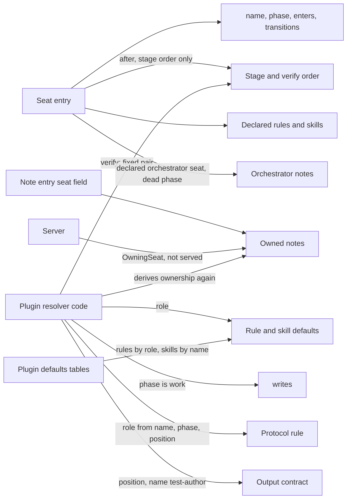
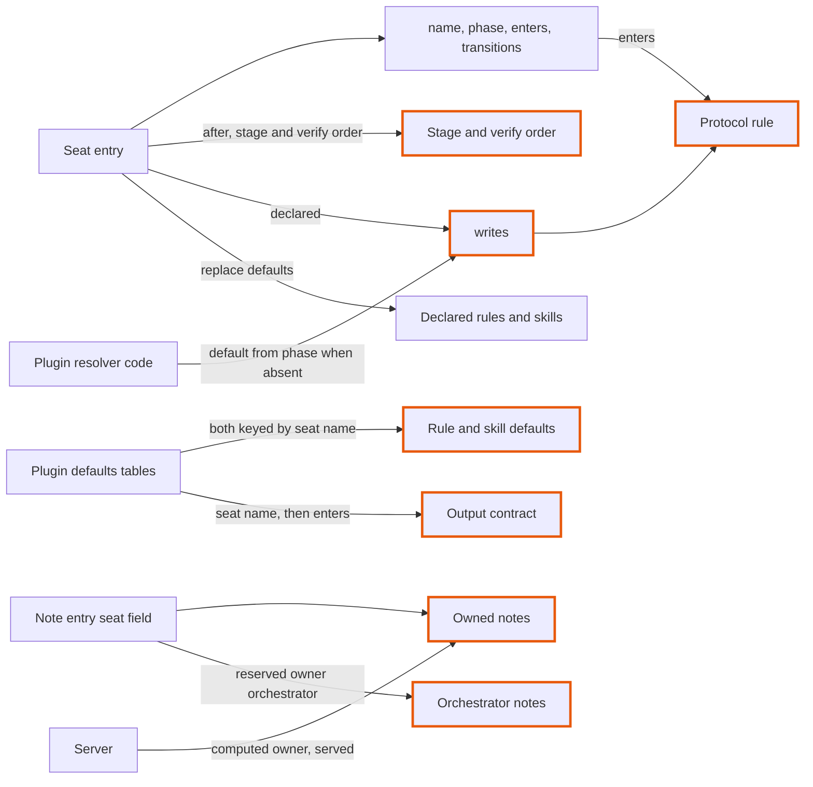

# Seat model

What a seat is in Task Orchestrator, where each seat attribute comes from today and in the target, how a seat's protocol rule is chosen, and how the orchestrator stays apart from the seats it drives. It is for whoever changes the server's seat contract, the plugin's seat resolver, run planner or rule tables, or a project's `seats:` config, and for a reviewer judging such a change. It describes the state of 2026-11-26 (origin/main `ce75ca2a8`) and the agreed target; the reasons are in [0016](decisions/0016-seat-capability-and-orchestrator-notes.md) and [0017](decisions/0017-orchestrator-binding.md). Terms follow [GLOSSARY.md](../GLOSSARY.md); a term marked "(proposed glossary entry)" goes into it when its code lands.

Path prefixes: `KT/` is `current/src/main/kotlin/io/github/jpicklyk/mcptask/current/`; `PLUG/` is `claude-plugins/task-orchestrator/`; `CFG` is the dogfood config, `.taskorchestrator/config.yaml`.

## What a seat is

A seat is a declared position in one phase of one type's workflow, filled by one dispatched agent, which holds one seat token inside a run. The server holds the facts it can check (name, phase, entry, triggers, which notes the seat owns) and serves every declared attribute, including those it never acts on. The plugin chooses a seat's protocol rule from served facts and its defaults from one key. The project declares the rest.

Invariants that hold today and stay in the target:

- A schema is seat-aware when it declares at least one seat (`KT/model/schema/WorkItemSchema.kt:43`). Seat enforcement applies only to a member of a run that is not closed, and a human caller is exempt (`KT/lifecycle/TransitionPolicy.kt:108-125`, `KT/note/internal/domain/NoteSeatRule.kt:38-40`). Outside an open run, seats are a signal to the orchestrator.
- One rule decides which seat owns a note, and every caller goes through it (`KT/model/note/OwningSeat.kt:5-28`).
- The structural checks at load and push stay as they are: reserved names, unique names, one entering seat per phase, no `complete` or `cancel` on an entering seat, no `after` cycle (`KT/config/internal/wire/YamlSchemaParser.kt:882-951`).
- `rules` and `skills` are served as declared and never enforced by the server (`KT/model/schema/SeatDefinition.kt:59-64`).
- A seat-less item can still be assigned the server's default seats (`KT/model/run/RunSeat.kt:90-100`).

The orchestrator is never a seat in the target. What today is called the orchestrator seat becomes the orchestrator note, the run's identity is the run token, and the orchestrator's own rules and skills attach through the orchestrator binding. Each has its own section below.

## Declared, served, derived

"Declared" means the project writes it in a seat entry or note entry. "Served" means the server returns it in `items_read` `schema` or `config` `effective`. "Derived" means plugin code works it out from something else; a derivation from a name, a phase or a position is what the target removes.

| Attribute | Today | Target |
|---|---|---|
| `name`, `phase` | Declared, required; a seat without a valid phase is skipped with a warning (`YamlSchemaParser.kt:671-680`); served | Unchanged. Seat names `orchestrator` and `coordinator` warn for one release, then are refused like `unowned` and `director` |
| `enters` | Declared, served; the server lets the entering seat `start` into its phase (`TransitionPolicy.kt:357-367`); the plugin reads it only to demote the implementer row's protocol (`PLUG/hooks/lib/seat-rules.mjs:81-90`) | Unchanged field; the plugin's protocol choice reads it for every seat |
| `transitions` | Declared, served, enforced by the server (`TransitionPolicy.kt:366`); no protocol rule or dispatch reflects it (`PLUG/bundled-rules/protocol.in-phase-seat.md:10-12`) | Unchanged field; the dispatch lists the seat's effective triggers |
| `after` | Declared, served; the run planner orders stages by it (`PLUG/scripts/run-planner-lib.mjs:665-680`); verify uses a fixed implementer-then-test-author order (`PLUG/scripts/run-exec-lib.mjs:1436-1448`) | Unchanged field; verify compares commits against the plan's `after` order too |
| `reads_exclude` | Declared, served, never enforced; the extractor stage is inserted only for a seat named `test-author` (`run-planner-lib.mjs:883`) | Unchanged field; the extractor is inserted only when a writing seat precedes the blind seat |
| `writes` | Not a field. Derived from the phase: `writes = phase === 'work'` (`run-planner-lib.mjs:874`, `PLUG/hooks/seat-skill-hint.mjs:147`) | Declared, optional (proposed glossary entry: Writing seat); default true in the work phase, false elsewhere; parsed and served, never enforced |
| Protocol rule | Derived from a role the plugin works out from name, phase, output contract and position (`seat-rules.mjs:58-75`), then looked up by role (`PLUG/hooks/lib/seat-rules.json`) | Chosen from served `enters` and `writes` only (next section) |
| Rule defaults | Keyed by the derived role (`seat-rules.json`) | Keyed by seat name |
| Skill defaults | Keyed by seat name (`PLUG/hooks/lib/seat-skill-defaults.json`, `PLUG/hooks/lib/seat-skills.mjs:46-52`) | Unchanged key |
| Declared `rules`, `skills` | Declared, served; a declared list replaces the defaults (`seat-rules.mjs:104-133`, `seat-skills.mjs:46-52`) | Unchanged |
| Owned notes | Derived by the server from the note entry's `seat` (`OwningSeat.kt:20-28`), and derived again by the plugin (`run-planner-lib.mjs:602-612`); in a seat-less schema the plugin keeps its own key list (`run-planner-lib.mjs:546-551`) | The server serves each note entry's computed owner in `items_read` `schema`; the plugin reads it in every schema |
| Output contract | Derived from position, `enters` and the name `test-author` (`run-planner-lib.mjs:871-881`) | By seat name, then `enters` |
| Dispatch class | By seat name, then phase (`run-planner-lib.mjs:631-641`) | Unchanged rule; the class for a run's orchestrator is renamed from `coordinator` to `orchestrator` |
| Lane and ralph seat names | Fixed: review lanes assign `reviewer` (`run-exec-lib.mjs:1846`), ralph assigns `implementer` (`PLUG/scripts/ralph-lib.mjs:431`) | Taken from the declared seats of the item's schema |

The whole server side of the target sits behind one server feature flag for the seat-model change set (`writes`, the refused names, the served owner, the orchestrator binding), so the plugin keeps one fallback branch. None of it needs a migration. The packages that carry it are P9, then P11 and P12, in [architecture-breakdown.md](architecture-breakdown.md); the config contract is in [config-layering.md](config-layering.md).

## Where each attribute comes from

Today: four attributes come from plugin code that reads names, phases and positions, and the orchestrator's notes need a seat entry whose phase does nothing.



Target: the plugin resolver keeps one documented default (`writes` from the phase when it is not declared); everything else is declared or served.



## `writes` and the protocol rule

A writing seat (proposed glossary entry) changes files in the item's worktree and commits them; every seat, writing or not, writes its own notes. `writes` is a capability fact beside `enters` and `transitions`, not a role. Today the plugin guesses it from the phase, so every review-phase seat is a read-only reviewer (`seat-rules.mjs:62`) and a review fix seat cannot commit.

Target: the plugin chooses a seat's protocol rule with one function over served facts:

| Served facts | Protocol rule |
|---|---|
| `enters: true` | `protocol.entry-seat` |
| not entering, `writes: true` | `protocol.in-phase-seat` |
| not entering, `writes: false` | `protocol.read-only-agent` |
| `writes: true` (added to either rule above) | `protocol.commit` |

`protocol.commit` carries the mechanical half of today's `commit-discipline` (item tag, `Seat:` trailer, path-scoped commits), which verify reads. The style half becomes the seat default `commit-message`. That leaves exactly two rule classes, protocol rules and seat defaults; [0018](decisions/0018-content-placement.md) records the classes, [0016](decisions/0016-seat-capability-and-orchestrator-notes.md) the choice from `enters` and `writes`.

Triggers follow the same idea. The dispatch lists the seat's effective `transitions` (plus `start` when the seat enters), and every protocol rule says "send only the triggers your dispatch lists". The server's seat gate stays the enforcement (`TransitionPolicy.kt:357-367`); the protocol text stops contradicting it. Today an entering seat that is not the implementer is told never to start (`protocol.in-phase-seat.md:7-9`), and a declared `transitions: [complete]` is honoured by the server and denied by the prose.

What moves for the dogfood config: the planner declares no `writes`, so it moves from `protocol.in-phase-seat` to `protocol.read-only-agent`, which matches its agent definition. The implementer enters and writes; the reviewer neither enters nor writes; the dogfood seat entries need no new field.

## Defaults by seat name, replaced by a declared list

Target: the plugin's rule defaults and skill defaults are both keyed by seat name. A seat that declares `rules:` or `skills:` replaces the defaults for that list, and no declared list removes a protocol rule. A seat whose name has no defaults row gets no rule or skill defaults and draws a lint advisory; its dispatch class still falls back to its phase. A project with its own seat names declares `rules:`, `skills:` and a trait dispatch override, all of which exist today.

There is no `kind` field: a second name for a seat that only selects defaults is held until a project asks for one name to inherit another's defaults ([0016](decisions/0016-seat-capability-and-orchestrator-notes.md), Reopen when). Where the plugin's defaults tables and the project's lists sit among the config layers is in [config-layering.md](config-layering.md).

## Stage order, verify and test-first

`after` is the one order. The run planner already sorts stages by it inside a phase. In the target, verify compares the item's commits against the plan's stage order instead of a fixed implementer-then-test-author pair, and the declarations extractor is inserted before a blind seat (`reads_exclude`) only when a writing seat precedes it in that order, since before that there is no code to extract.

That makes test-first expressible. The server already allows it (`TransitionPolicy.kt:357-367`); today the plugin gives an entering `test-author` the implementer's output contract (`run-planner-lib.mjs:879`) and verify reports its earlier commit as a finding. Target config:

```yaml
seats:
  - { name: test-author, phase: work, enters: true, writes: true, reads_exclude: [implementation-notes] }
  - { name: implementer, phase: work, after: [test-author], writes: true }
```

The test author gets `protocol.entry-seat` and `protocol.commit`, its own output contract by name, and no extractor stage; the implementer gets `protocol.in-phase-seat`; verify passes because the commits follow `after`. Whether a new test must fail before the fix stays the project's rule, not a seat fact. How a run executes stages and verify is in [run-execution.md](run-execution.md).

## Fix seats

A fix cycle reseats a base seat under the plugin-only name `<seat>-a<n>`; the server knows only the base seat, and the fix stage uses the base seat's token (`run-exec-lib.mjs:679-681`). Today the fix seat keeps its role only because the role function strips the suffix (`seat-rules.mjs:70`), and the reseat prompt tells every base seat to commit, a planner included (`run-exec-lib.mjs:687`, `:702`).

Target: the reseat stage copies the base seat's `writes` and reads the base seat's defaults row by its name, and the commit sentence is rendered only when the base seat writes. A review phase that should fix what it finds declares its own writing seat, for example `{ name: fixer, phase: review, writes: true, transitions: [block, hold] }`; today that seat would be a read-only reviewer by phase.

## The orchestrator note

Today a note entry labelled `seat: orchestrator` is owned by the reserved `orchestrator` seat only when a seat of that name is declared in some phase (`OwningSeat.kt:26`), so the dogfood config declares `{ name: orchestrator, phase: work, after: [implementer] }` whose `phase` and `after` do nothing (`CFG:61`, `:86`), and the run planner skips it as a stage (`run-planner-lib.mjs:858`).

Target: `orchestrator` is a reserved note owner, valid in every schema, and no seat is declared for it. A note naming it is an orchestrator note (proposed glossary entry): the orchestrator writes it, with the run token inside an open run of a seat-aware schema (`NoteSeatRule.kt:61` is unchanged), directly outside one. The wire form `seat: orchestrator` on the note entry is unchanged. The server serves the computed owner, so the plugin stops deriving it. The dogfood config drops its two phased entries and the trait dispatch override for `orchestrator` (`CFG:221`). Why it is not a seat: [0016](decisions/0016-seat-capability-and-orchestrator-notes.md).

## The run token

The run token is the credential `runs_write` `open` returns and `reissue` replaces: the server's only proof that a caller is a run's orchestrator (`KT/run/internal/app/RunPermissions.kt:47-54`). It may send any trigger on any member of its run (`TransitionPolicy.kt:327`), write orchestrator notes, assign seats and close the run. It fills no seat.

Today it is stored as the one `run_seats` row with no item, whose `seat` value is `coordinator` (`KT/model/run/RunSeat.kt:69`, `:88`), and the served `seat_forbidden` detail lists that value among the allowed seats (`TransitionPolicy.kt:377`). Target: the wire key `orchestratorToken` (alias `coordinatorToken` until 5.0), the stored value and the `coordinator_seen_at` column are unchanged under [0005](decisions/0005-renames-with-deprecated-aliases.md); the store gives member seats and the run token separate reads so its readers stop filtering the row out; `allowedSeats` stops listing `coordinator`. An entry skill acting on an open-run member uses the run token from the run files or hands the step to that run's orchestrator; there is no new server rule ([0016](decisions/0016-seat-capability-and-orchestrator-notes.md)). Where the token is checked is in [enforcement-map.md](enforcement-map.md).

## The orchestrator binding

Today the orchestrator's own conduct rules and skills reach it only as prose in hooks and skills; no config binds them, and the role function returns nothing for `orchestrator` (`seat-rules.mjs:61`).

Target: the `orchestrator:` config block (`rules`, `skills`) at config root and on a trait binds them; a schema reaches a trait's binding through `default_traits`. It is not a seat and never makes a type seat-aware. `protocol.orchestrator` is always given first. The plugin delivers one resolved rules and skills line at SessionStart, in the background orchestrator's brief and in the run plan. Its levels, merge and the held knowledge-session question: [0017](decisions/0017-orchestrator-binding.md) and [config-layering.md](config-layering.md).

## Related documents

- [target-architecture.md](target-architecture.md): zones and the matrix rows this model closes (M11-M19); the packages that carry it are P9, P11 and P12 in [architecture-breakdown.md](architecture-breakdown.md).
- [seams.md](seams.md): the seat seams (seat facts, `writes`, rule and skill tables, served owner, effective transitions) with their writers and readers.
- [journey-overlay.md](journey-overlay.md): the journey steps that cross the seat model.
- [glossary-alignment.md](glossary-alignment.md): the earlier ruling to keep the orchestrator seat, superseded by 0016.
