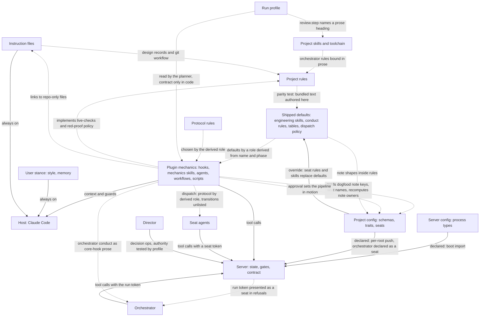
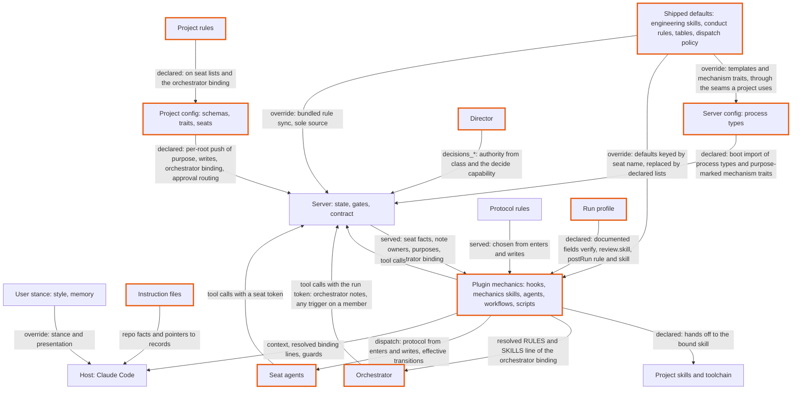

# System context

The context map of Task Orchestrator: the zones and actors of [target-architecture.md](target-architecture.md) as nodes, and the edges between them labelled with what crosses and what kind of edge it is, drawn once as it is today and once as the target. It is for contributors and reviewers who need to see at a glance which way a dependency runs and which edges no contract declares. The "today" diagram describes origin/main `ce75ca2a8` on 2026-11-26; the "target" diagram is not built. Both diagrams use the same node names, so only edges and labels move. Edge ids such as S05 are seams in [seams.md](seams.md).

## Edge legend

| Kind | Drawn as | Meaning |
|---|---|---|
| **served fact** | solid, label starts `served:` | The server serves a fact and the reader acts on it without deriving it again |
| **declared list** | solid, label starts `declared:` | A project or operator declares config through a published seam; the reader takes it as written |
| **override** | solid, label starts `override:` | A shipped default reaches the platform through the same seam a project uses to replace it |
| **conformist** | dotted | One side adopts the other's model with no contract declaring it: reading another zone's names, prose or layout. Every dotted edge is a leak |

Edges with no kind prefix only deliver (tool calls, context injection): they carry content and decide nothing.

## Today

## Target

## What moves

- **The plugin stops reading the project.** Every dotted edge from plugin mechanics becomes a served fact or a declared list: note jobs come from note `purpose` (S05), note owners from the served owner (S64), seat capability from `writes` (S09), stage order from `after` (S08), post-run procedures from `postRun[].skill` (S30), a rule's hold list from `ruleOutputs.hold` (S41), what plan approval sets in motion from approval routing (S22).
- **The orchestrator is never a seat.** Today the project declares a seat named `orchestrator` to make orchestrator notes owned, and the server lists the run token among the seats in a refusal. In the target, `seat: orchestrator` on a note entry is a reserved owner valid in every schema (S14), the run token is described only as a token (S39, S65), and the orchestrator's conduct comes from the orchestrator binding (S13), delivered as one resolved line (S45) instead of core-hook prose ([0016](decisions/0016-seat-capability-and-orchestrator-notes.md), [0017](decisions/0017-orchestrator-binding.md)).
- **Seats get facts, not a guessed role.** The protocol rule is chosen from served `enters` and `writes`, defaults are keyed by seat name, and the dispatch lists the seat's effective `transitions` (S24, S44; [seat-model.md](seat-model.md)).
- **Decision authority leaves the profile.** The director's decision ops move from the director profile, where authority is tested by profile, to `decisions_*` on every profile that needs them, with authority from the decision class and the credential ([0003](decisions/0003-role-neutral-decisions-surface.md)).
- **The server config gains the mechanism traits**, and the bundled rules become the only source of their own text: dogfood copies go ([config-layering.md](config-layering.md)).
- **The instruction file keeps facts and pointers.** Design records and process move to decision records, project rules and the skills that own them ([0018](decisions/0018-content-placement.md)).
- **The user's stance overrides presentation** through the output style instead of the core hook carrying a presentation of its own (S46, S48).
